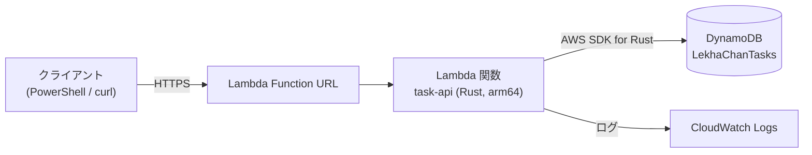
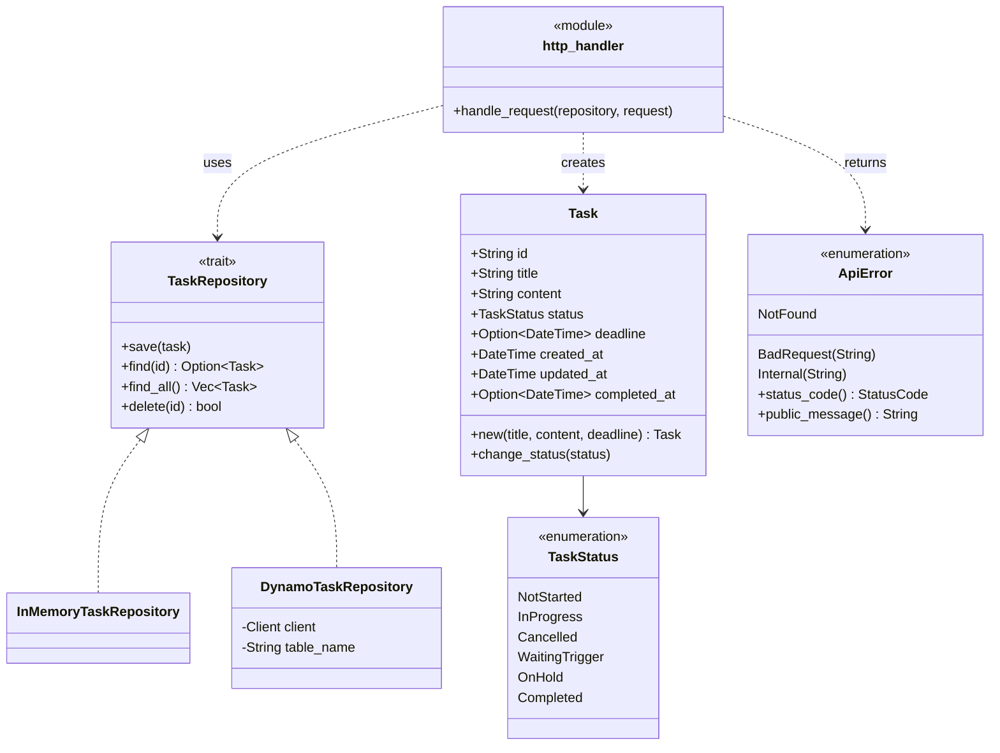
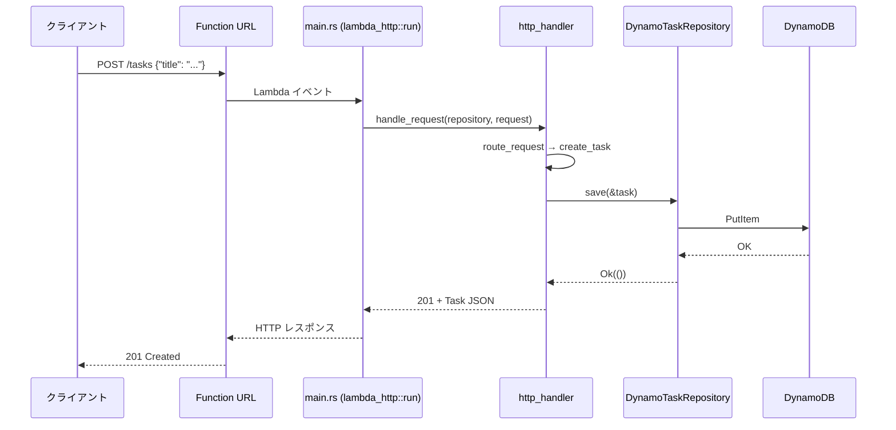

# Rust × AWS Lambda ハンズオン（サーバーサイド）

[English version](RustLambdaHandsOn.md)

Rust が入っていない状態から始めて、**Rust で書いたタスク管理 REST API を AWS Lambda 上で動かす**までを、手を動かしながら進めるガイドです。データは DynamoDB に保存します。
Rust を初めて書く人向けです。各ステップで少しずつコードを足していき、そこで使う Rust の概念を **🦀 Rust ポイント** で解説します。

> 対象範囲：サーバーサイドのみ（Lambda + DynamoDB）。フロントエンドは扱いません。

## 目次

0. [作るもの](#0-作るもの)
1. [環境構築（Windows）](#1-環境構築windows)
2. [Step 1: Hello Lambda](#2-step-1-hello-lambda)
3. [Step 2: タスクのドメインモデル](#3-step-2-タスクのドメインモデル)
4. [Step 3: リポジトリの抽象化](#4-step-3-リポジトリの抽象化)
5. [Step 4: HTTP ルーティング](#5-step-4-http-ルーティング)
6. [Step 5: DynamoDB に保存する](#6-step-5-dynamodb-に保存する)
   - [幕間：Rust のコーディング慣習（命名規則とファイル分け）](#幕間rust-のコーディング慣習命名規則とファイル分け)
7. [Step 6: AWS にデプロイ](#7-step-6-aws-にデプロイ)
8. [Step 7: 後片付け](#8-step-7-後片付け)
9. [トラブルシューティング](#9-トラブルシューティング)
10. [次のステップ](#10-次のステップ)

### 動作確認環境

本ガイドのコマンドとコードは、2026-10-30 に以下の環境ですべて実行して確認済みです。

| 項目 | バージョン |
| --- | --- |
| OS | Windows 11（PowerShell 5.1） |
| Rust（rustc / cargo） | 1.99.1 |
| cargo-lambda | 1.9.2 |
| Zig | 0.16.0 |
| AWS CLI | 2.35.3 |
| lambda_http | 1.3.2 |
| aws-config / aws-sdk-dynamodb | 1.13.0 / 1.135.0 |

---

## 0. 作るもの

LekhaChan の **タスク**（[Requirements.md](Requirements.md) 参照）の最小版を REST API として公開します。

| メソッド | パス | リクエストボディ | 成功時のレスポンス |
| --- | --- | --- | --- |
| `POST` | `/tasks` | `{"title", "content"?, "deadline"?}` | `201` + Task |
| `GET` | `/tasks` | – | `200` + Task[] |
| `GET` | `/tasks/{id}` | – | `200` + Task |
| `PATCH` | `/tasks/{id}/status` | `{"status"}` | `200` + Task |
| `DELETE` | `/tasks/{id}` | – | `204` |

エラー時はステータス `400` / `404` / `500` とともに `{"error": "..."}` を返します。

`status` の値は `notStarted`（未着手）、`inProgress`（進行中）、`cancelled`（中止）、`waitingTrigger`（トリガー待ち）、`onHold`（保留）、`completed`（完了）のいずれかで、要件定義の「状態」に対応します。

### アーキテクチャ



### クラス図

ファイルごとに責務を 1 つだけ持たせます。HTTP ハンドラは `TaskRepository` トレイトにだけ依存するので、ハンドラに手を入れずに保存先を差し替えられます（テストではメモリ、本番では DynamoDB）。



### シーケンス：`POST /tasks`



### 最終的なファイル構成

```text
task-api/
├─ Cargo.toml                       # パッケージ定義（package.json に相当）
├─ iam/
│  ├─ trust-policy.json             # Lambda ロールを引き受けられる主体
│  └─ dynamodb-policy.json          # Lambda が DynamoDB でできること
└─ src/
   ├─ main.rs                       # エントリーポイント：組み立てのみ
   ├─ task.rs                       # ドメインモデル
   ├─ task_repository.rs            # 保存先の抽象（トレイト）
   ├─ in_memory_task_repository.rs  # テスト用の保存先
   ├─ dynamo_task_repository.rs     # 本番用の保存先
   ├─ api_error.rs                  # エラー → HTTP ステータスの対応
   └─ http_handler.rs               # ルーティングと HTTP 変換
```

> **ファイル名について：** Rust ではファイル名がそのままモジュール名になり、`snake_case` でないとコンパイラが警告を出します。
> そのため本ガイドでは、リポジトリのファイル名規約（UpperCamelCase）ではなく Rust の慣例に従います。
> Rust の命名規則とファイル分けの慣習は [幕間](#幕間rust-のコーディング慣習命名規則とファイル分け) でまとめて解説します。

---

## 1. 環境構築（Windows）

コマンドはすべて **PowerShell** で実行します。インストールのたびに **新しいターミナルを開き直して**、`PATH` を読み込み直してください。

### 1.1 C++ ビルドツール（リンカー）

Windows 版 Rust は MSVC のリンカー（`link.exe`）を使います。
Visual Studio に **「C++ によるデスクトップ開発」** ワークロードが入っていれば、この手順は不要です。
入っていない場合は「Build Tools for Visual Studio」をインストールし、Visual Studio Installer でこのワークロードを選んでください。

### 1.2 Rust

```powershell
winget install --id Rustlang.Rustup -e
```

新しいターミナルで：

```powershell
rustup default stable                          # stable ツールチェーンを入れる（導入済みなら何もしない）
rustup target add aarch64-unknown-linux-gnu    # Lambda（Linux, arm64）向けの標準ライブラリ
rustc --version
cargo --version
```

`rustup` で `rustc`（コンパイラ）、`cargo`（ビルドツール兼パッケージマネージャー）、`rustfmt`（フォーマッター）、`clippy`（リンター）がまとめて入ります。

### 1.3 VS Code 拡張機能

```powershell
code --install-extension rust-lang.rust-analyzer
```

rust-analyzer を入れると、補完・型ヒントのインライン表示・エラーのハイライトが使えます。Rust に慣れないうちは、特に型ヒントが助けになります。

### 1.4 cargo-lambda（と Zig）

[cargo-lambda](https://www.cargo-lambda.info/) は、Rust 製 Lambda 関数の作成・ローカル実行・ビルド・デプロイを担うツールです。
WinGet でインストールすると [Zig](https://ziglang.org/) も一緒に入ります。Zig は Windows から Linux 向けにクロスコンパイルするのに使います。

```powershell
winget install --id CargoLambda.CargoLambda -e
```

新しいターミナルで：

```powershell
cargo lambda --version   # cargo-lambda 1.9.2 ...
zig version              # 0.13.0 以上
```

`zig` が見つからない場合は `winget install --id zig.zig -e` を実行してください。

### 1.5 AWS CLI と認証情報

本ガイドではリージョン **ap-northeast-1（東京）** を使います。

```powershell
aws --version
aws login                     # ブラウザで AWS コンソールの認証情報を使ってサインイン
aws sts get-caller-identity   # 認証できていればアカウント ID が表示される
aws configure get region      # ap-northeast-1 と表示されればOK
```

#### cargo-lambda 用の中継プロファイル

cargo-lambda 1.9.2 に同梱されている AWS SDK は、**`aws login` のセッションを読めません**。
そのままデプロイすると `the credential provider was not enabled` で失敗します。
回避策として、AWS CLI に認証情報を問い合わせるプロファイル（`credential_process`）を追加します。

設定ファイルを開きます：

```powershell
code $env:USERPROFILE\.aws\config
```

末尾に次を追記します。名前付きプロファイルで `aws login` した場合は、`default` をそのプロファイル名に置き換えてください。

```ini
[profile cargo-lambda]
credential_process = aws configure export-credentials --profile default --format process
region = ap-northeast-1
```

確認：

```powershell
aws sts get-caller-identity --profile cargo-lambda
```

> `aws login` ではなく IAM Identity Center（`aws configure sso`）やアクセスキーを使っている場合、このプロファイルは不要です。Step 6 の `--profile` には自分のプロファイル名を指定してください。

#### macOS / Linux の場合

`curl https://sh.rustup.rs -sSf | sh` と `brew install cargo-lambda/tap/cargo-lambda` でインストールします。
以降の手順は、API の呼び出しを `Invoke-RestMethod` の代わりに `curl` で行う点以外は同じです。

---

## 2. Step 1: Hello Lambda

### 2.1 プロジェクト作成

プロジェクトは **短いパス** に作ってください。Windows のツールにはパス長 260 文字の制限があり、深いフォルダだとビルドが失敗することがあります（[トラブルシューティング](#9-トラブルシューティング)参照）。

```powershell
mkdir C:\Dev -Force
cd C:\Dev
cargo lambda new task-api --http -y
cd task-api
code .
```

`--http` で HTTP 用テンプレートを選び、`-y` で質問にすべて既定値で答えます。

```text
task-api/
├─ .gitignore      # target/（ビルド成果物）を除外
├─ Cargo.toml
├─ README.md
└─ src/
   ├─ main.rs
   └─ http_handler.rs
```

### 2.2 生成されたコードを読む

`src/main.rs`：

```rust
use lambda_http::{run, service_fn, tracing, Error};
mod http_handler;
use http_handler::function_handler;

#[tokio::main]
async fn main() -> Result<(), Error> {
    tracing::init_default_subscriber();

    run(service_fn(function_handler)).await
}
```

`src/http_handler.rs` の中心部分：

```rust
pub(crate) async fn function_handler(event: Request) -> Result<Response<Body>, Error> {
    // Extract some useful information from the request
    let who = event
        .query_string_parameters_ref()
        .and_then(|params| params.first("name"))
        .unwrap_or("world");
    let message = format!("Hello {who}, this is an AWS Lambda HTTP request");
    // ...`message` をボディにした 200 レスポンスを組み立てる
}
```

> **🦀 Rust ポイント：Cargo・クレート・モジュール**
> - **Cargo** はビルドツール兼パッケージマネージャーです（`pnpm` + `tsc` のようなもの）。`Cargo.toml` が `package.json` に相当し、ライブラリは **クレート** と呼びます。
> - `mod http_handler;` で **モジュール** を宣言すると、その中身は `src/http_handler.rs` に書きます。どこかで `mod` 宣言しない限り、ファイルはビルド対象になりません。
> - `use` は名前をスコープに取り込みます。`import` に相当します。

> **🦀 Rust ポイント：async と `Result`**
> - Rust には非同期ランタイムが組み込まれていません。`#[tokio::main]` で **tokio** ランタイムを起動し、`async fn main` を動かします。
> - Rust には例外がありません。失敗しうる関数は `Result<T, E>` を返し、その値は `Ok(値)` か `Err(エラー)` のどちらかです。
> - `.unwrap_or("world")` は「値があるかもしれない」（`Option`）を、既定値を指定して値に変換します。

### 2.3 動かす

テストを実行します（テンプレートに 2 つ付いています）：

```powershell
cargo test
```

**ターミナル A** でローカルの Lambda エミュレーターを起動します。ファイルを保存するたびに自動で再ビルドされます。

```powershell
cargo lambda watch
```

**ターミナル B** から呼び出します：

```powershell
Invoke-RestMethod "http://localhost:9000/?name=Rust"
# => Hello Rust, this is an AWS Lambda HTTP request
```

✏️ **やってみよう：** `http_handler.rs` のメッセージを書き換えて保存し、もう一度呼び出してみましょう。エミュレーターが自動で読み込み直します。

---

## 3. Step 2: タスクのドメインモデル

### 3.1 依存クレートの追加

```powershell
cargo add serde --features derive   # シリアライズ／デシリアライズの基盤
cargo add serde_json                 # serde の JSON 対応
cargo add chrono --features serde    # 日時
cargo add uuid --features v4         # ランダムな ID
cargo add thiserror                  # エラー型を簡潔に定義
```

### 3.2 `src/task.rs`

ファイルを作成します：

```rust
//! Domain model of a LekhaChan task.

use chrono::{DateTime, Utc};
use serde::{Deserialize, Serialize};
use uuid::Uuid;

/// Progress state of a task.
#[derive(Debug, Clone, Copy, PartialEq, Eq, Serialize, Deserialize)]
#[serde(rename_all = "camelCase")]
pub enum TaskStatus {
    NotStarted,
    InProgress,
    Cancelled,
    WaitingTrigger,
    OnHold,
    Completed,
}

/// A unit of work managed by LekhaChan.
#[derive(Debug, Clone, PartialEq, Serialize, Deserialize)]
#[serde(rename_all = "camelCase")]
pub struct Task {
    /// Unique ID (UUID v4).
    pub id: String,
    /// Short title shown in lists.
    pub title: String,
    /// Task summary in Markdown.
    pub content: String,
    /// Current progress state.
    pub status: TaskStatus,
    /// Deadline, if any.
    pub deadline: Option<DateTime<Utc>>,
    /// When the task was created.
    pub created_at: DateTime<Utc>,
    /// When the task was last modified.
    pub updated_at: DateTime<Utc>,
    /// When the task became Completed; None otherwise.
    pub completed_at: Option<DateTime<Utc>>,
}

impl Task {
    /// Creates a new task in NotStarted status.
    pub fn new(title: String, content: String, deadline: Option<DateTime<Utc>>) -> Self {
        let now = Utc::now();
        Self {
            id: Uuid::new_v4().to_string(),
            title,
            content,
            status: TaskStatus::NotStarted,
            deadline,
            created_at: now,
            updated_at: now,
            completed_at: None,
        }
    }

    /// Changes the status, keeping updated_at and completed_at consistent.
    pub fn change_status(&mut self, status: TaskStatus) {
        let now = Utc::now();
        self.status = status;
        self.updated_at = now;
        self.completed_at = if status == TaskStatus::Completed {
            Some(now)
        } else {
            None
        };
    }
}

#[cfg(test)]
mod tests {
    use super::*;

    #[test]
    fn new_task_starts_as_not_started() {
        let task = Task::new("Write Rust".to_string(), String::new(), None);

        assert_eq!(task.status, TaskStatus::NotStarted);
        assert_eq!(task.completed_at, None);
    }

    #[test]
    fn completing_task_sets_completed_at() {
        let mut task = Task::new("Write Rust".to_string(), String::new(), None);

        task.change_status(TaskStatus::Completed);
        assert!(task.completed_at.is_some());

        task.change_status(TaskStatus::InProgress);
        assert_eq!(task.completed_at, None);
    }

    #[test]
    fn task_serializes_in_camel_case() {
        let task = Task::new("Write Rust".to_string(), String::new(), None);

        let json = serde_json::to_value(&task).unwrap();

        assert_eq!(json["status"], "notStarted");
        assert!(json.get("createdAt").is_some());
    }
}
```

`src/main.rs` の `mod http_handler;` の下に 1 行足して、モジュールを登録します：

```rust
mod task;
```

```powershell
cargo test   # 5 passed（テンプレート 2 + 新規 3）
```

`struct Task is never constructed` のような警告が出ますが、想定どおりです。Step 4 でこのコードを使うようになります。

> **🦀 Rust ポイント：struct・enum・derive**
> - `struct` はフィールドをまとめる型です。`enum` は取りうる値（バリアント）を列挙した型で、後に出てくる `ApiError` のようにバリアントにデータを持たせることもできます。
> - `#[derive(...)]` は定番の振る舞いを自動生成します。`Debug`（`{:?}` で表示）、`Clone`（`.clone()`）、`PartialEq`（`==`）、`Serialize`/`Deserialize`（serde による JSON 変換）。
> - `#[serde(rename_all = "camelCase")]` で、Rust 側の `created_at` を JSON 側では `createdAt` にします。

> **🦀 Rust ポイント：null の代わりに `Option`**
> - Rust に `null` はありません。無いかもしれない値は `Option<T>` 型で表し、その値は `Some(値)` か `None` です。両方のケースを処理しないとコンパイルが通りません。

> **🦀 Rust ポイント：所有権と借用**
> - `String` は **所有する** 文字列、`&str` はそれを **借用した** 参照です。`"Write Rust".to_string()` で所有する文字列のコピーを作ります。
> - `Task::new(title: String, ...)` は引数の所有権を受け取ります。文字列は `Task` の中に **ムーブ** され、呼び出し側では以後使えなくなります。
> - 変数は既定で不変です。`let mut task` で可変にでき、`&mut self` は「このメソッドはタスクを可変で借用する」という意味です。

> **🦀 Rust ポイント：テストはコードの隣に書く**
> - `#[cfg(test)] mod tests { ... }` は `cargo test` のときだけコンパイルされます。`use super::*;` で親モジュールの要素をすべて取り込みます。

---

## 4. Step 3: リポジトリの抽象化

ハンドラは「タスクがどこに保存されるか」を知らなくてよいはずです。そこで保存操作を **トレイト**（インターフェース）として定義し、2 通りに実装します。今回はメモリ版、Step 5 で DynamoDB 版を作ります。

### 4.1 `src/task_repository.rs`

```rust
//! Storage abstraction for tasks, so handlers do not depend on a concrete database.

use std::future::Future;

use crate::task::Task;

/// Failure inside a TaskRepository implementation.
#[derive(Debug, thiserror::Error)]
#[error("repository error: {0}")]
pub struct RepositoryError(pub String);

/// Persistent store of tasks.
pub trait TaskRepository: Send + Sync {
    /// Inserts the task, or overwrites it if the ID already exists.
    fn save(&self, task: &Task) -> impl Future<Output = Result<(), RepositoryError>> + Send;

    /// Finds a task by ID; Ok(None) if it does not exist.
    fn find(&self, id: &str) -> impl Future<Output = Result<Option<Task>, RepositoryError>> + Send;

    /// Returns every task.
    fn find_all(&self) -> impl Future<Output = Result<Vec<Task>, RepositoryError>> + Send;

    /// Deletes a task by ID; Ok(false) if it did not exist.
    fn delete(&self, id: &str) -> impl Future<Output = Result<bool, RepositoryError>> + Send;
}
```

### 4.2 `src/in_memory_task_repository.rs`

```rust
//! TaskRepository that keeps tasks in process memory, for tests and local trials.

use std::collections::HashMap;
use std::sync::{Mutex, MutexGuard};

use crate::task::Task;
use crate::task_repository::{RepositoryError, TaskRepository};

/// Tasks stored in a HashMap; lost when the process exits.
#[derive(Default)]
pub struct InMemoryTaskRepository {
    tasks: Mutex<HashMap<String, Task>>,
}

impl InMemoryTaskRepository {
    fn lock_tasks(&self) -> Result<MutexGuard<'_, HashMap<String, Task>>, RepositoryError> {
        self.tasks
            .lock()
            .map_err(|error| RepositoryError(error.to_string()))
    }
}

impl TaskRepository for InMemoryTaskRepository {
    async fn save(&self, task: &Task) -> Result<(), RepositoryError> {
        let mut tasks = self.lock_tasks()?;
        tasks.insert(task.id.clone(), task.clone());
        Ok(())
    }

    async fn find(&self, id: &str) -> Result<Option<Task>, RepositoryError> {
        let tasks = self.lock_tasks()?;
        Ok(tasks.get(id).cloned())
    }

    async fn find_all(&self) -> Result<Vec<Task>, RepositoryError> {
        let tasks = self.lock_tasks()?;
        Ok(tasks.values().cloned().collect())
    }

    async fn delete(&self, id: &str) -> Result<bool, RepositoryError> {
        let mut tasks = self.lock_tasks()?;
        Ok(tasks.remove(id).is_some())
    }
}
```

`src/main.rs` に 2 つのモジュールを追加します：

```rust
mod in_memory_task_repository;
mod task_repository;
```

```powershell
cargo build
```

> **🦀 Rust ポイント：トレイト**
> - `trait` は TypeScript のインターフェースのようなものです。`impl TaskRepository for InMemoryTaskRepository` で「この型はこの契約を満たす」と宣言します。
> - `Send + Sync` は「スレッド間で移動・共有しても安全」という印です。tokio はコードをどのスレッドで実行するかわからないので、共有するリポジトリはスレッドセーフである必要があります。

> **🦀 Rust ポイント：トレイトの async メソッド**
> - トレイト側では `impl Future<Output = ...> + Send` と明示して、返す Future がスレッドをまたげることを呼び出し側に保証しています。実装側は上のように `async fn` と書くだけで済みます。

> **🦀 Rust ポイント：`?` と `map_err`**
> - `式?` は「`Err` ならその場で関数から return し、`Ok` なら中身を取り出す」という意味です。try/catch の代わりになります。
> - `.map_err(|error| ...)` はエラーの型を変換します。`|error| ...` はクロージャ（ラムダ式）です。

> **🦀 Rust ポイント：`Mutex` と `.cloned()`**
> - メソッドは `&self`（共有の借用）を受け取りますが、HashMap は書き換える必要があります。それを安全に行うのが `Mutex` です。`lock()` で得たガードがスコープを抜けるまで、排他的にアクセスできます。
> - `.cloned()` でコピーを返しているのは、HashMap 内への参照はロックより長く生きられないためです。

---

## 5. Step 4: HTTP ルーティング

### 5.1 `src/api_error.rs`

```rust
//! Errors returned to API clients, each mapped to an HTTP status code.

use lambda_http::http::StatusCode;

use crate::task_repository::RepositoryError;

/// Error that ends a request with a non-2xx response.
#[derive(Debug, thiserror::Error)]
pub enum ApiError {
    /// The route or the task does not exist.
    #[error("not found")]
    NotFound,
    /// The client sent invalid input.
    #[error("bad request: {0}")]
    BadRequest(String),
    /// Something failed on the server side.
    #[error("internal error: {0}")]
    Internal(String),
}

impl ApiError {
    /// Returns the HTTP status code for this error.
    pub fn status_code(&self) -> StatusCode {
        match self {
            ApiError::NotFound => StatusCode::NOT_FOUND,
            ApiError::BadRequest(_) => StatusCode::BAD_REQUEST,
            ApiError::Internal(_) => StatusCode::INTERNAL_SERVER_ERROR,
        }
    }

    /// Returns the message shown to clients; internal details stay in the logs.
    pub fn public_message(&self) -> String {
        match self {
            ApiError::Internal(_) => "internal error".to_string(),
            other => other.to_string(),
        }
    }
}

// Lets `?` turn a RepositoryError into an ApiError automatically.
impl From<RepositoryError> for ApiError {
    fn from(error: RepositoryError) -> Self {
        ApiError::Internal(error.to_string())
    }
}
```

### 5.2 `src/http_handler.rs`

テンプレートのファイルを丸ごと次の内容に置き換えます：

```rust
//! Routes HTTP requests to task operations and converts results into HTTP responses.

use chrono::{DateTime, Utc};
use lambda_http::http::header::{HeaderValue, CONTENT_TYPE};
use lambda_http::http::{Method, StatusCode};
use lambda_http::{tracing, Body, Error, Request, Response};
use serde::de::DeserializeOwned;
use serde::{Deserialize, Serialize};

use crate::api_error::ApiError;
use crate::task::{Task, TaskStatus};
use crate::task_repository::TaskRepository;

/// Body of POST /tasks.
#[derive(Debug, Deserialize)]
#[serde(rename_all = "camelCase")]
struct TaskCreationRequest {
    title: String,
    #[serde(default)]
    content: String,
    deadline: Option<DateTime<Utc>>,
}

/// Body of PATCH /tasks/{id}/status.
#[derive(Debug, Deserialize)]
struct TaskStatusChangeRequest {
    status: TaskStatus,
}

/// Lambda entry point for every HTTP request; never fails, errors become JSON responses.
pub async fn handle_request<R: TaskRepository>(
    repository: &R,
    request: Request,
) -> Result<Response<Body>, Error> {
    match route_request(repository, &request).await {
        Ok(response) => Ok(response),
        Err(error) => {
            tracing::warn!(%error, "request failed");
            let json = serde_json::json!({ "error": error.public_message() }).to_string();
            Ok(build_json_response(error.status_code(), json))
        }
    }
}

async fn route_request<R: TaskRepository>(
    repository: &R,
    request: &Request,
) -> Result<Response<Body>, ApiError> {
    // "/tasks/abc/status" -> ["tasks", "abc", "status"]
    let segments: Vec<&str> = request
        .uri()
        .path()
        .split('/')
        .filter(|segment| !segment.is_empty())
        .collect();

    match (request.method(), segments.as_slice()) {
        (&Method::GET, ["tasks"]) => list_tasks(repository).await,
        (&Method::POST, ["tasks"]) => create_task(repository, request).await,
        (&Method::GET, ["tasks", id]) => get_task(repository, id).await,
        (&Method::PATCH, ["tasks", id, "status"]) => {
            change_task_status(repository, id, request).await
        }
        (&Method::DELETE, ["tasks", id]) => delete_task(repository, id).await,
        _ => Err(ApiError::NotFound),
    }
}

async fn list_tasks<R: TaskRepository>(repository: &R) -> Result<Response<Body>, ApiError> {
    let tasks = repository.find_all().await?;
    serialize_json_response(StatusCode::OK, &tasks)
}

async fn create_task<R: TaskRepository>(
    repository: &R,
    request: &Request,
) -> Result<Response<Body>, ApiError> {
    let creation: TaskCreationRequest = parse_json_body(request)?;
    if creation.title.trim().is_empty() {
        return Err(ApiError::BadRequest("title must not be empty".to_string()));
    }

    let task = Task::new(creation.title, creation.content, creation.deadline);
    repository.save(&task).await?;
    serialize_json_response(StatusCode::CREATED, &task)
}

async fn get_task<R: TaskRepository>(repository: &R, id: &str) -> Result<Response<Body>, ApiError> {
    let task = repository.find(id).await?.ok_or(ApiError::NotFound)?;
    serialize_json_response(StatusCode::OK, &task)
}

async fn change_task_status<R: TaskRepository>(
    repository: &R,
    id: &str,
    request: &Request,
) -> Result<Response<Body>, ApiError> {
    let change: TaskStatusChangeRequest = parse_json_body(request)?;

    let mut task = repository.find(id).await?.ok_or(ApiError::NotFound)?;
    task.change_status(change.status);
    repository.save(&task).await?;
    serialize_json_response(StatusCode::OK, &task)
}

async fn delete_task<R: TaskRepository>(
    repository: &R,
    id: &str,
) -> Result<Response<Body>, ApiError> {
    if !repository.delete(id).await? {
        return Err(ApiError::NotFound);
    }
    Response::builder()
        .status(StatusCode::NO_CONTENT)
        .body(Body::Empty)
        .map_err(|error| ApiError::Internal(error.to_string()))
}

fn parse_json_body<T: DeserializeOwned>(request: &Request) -> Result<T, ApiError> {
    serde_json::from_slice(request.body().as_ref())
        .map_err(|error| ApiError::BadRequest(error.to_string()))
}

fn serialize_json_response<T: Serialize>(
    status: StatusCode,
    value: &T,
) -> Result<Response<Body>, ApiError> {
    let json =
        serde_json::to_string(value).map_err(|error| ApiError::Internal(error.to_string()))?;
    Ok(build_json_response(status, json))
}

fn build_json_response(status: StatusCode, json: String) -> Response<Body> {
    let mut response = Response::new(Body::from(json));
    *response.status_mut() = status;
    // charset is required for non-ASCII text to display correctly in Windows PowerShell 5.1.
    response.headers_mut().insert(
        CONTENT_TYPE,
        HeaderValue::from_static("application/json; charset=utf-8"),
    );
    response
}

#[cfg(test)]
mod tests {
    use super::*;
    use crate::in_memory_task_repository::InMemoryTaskRepository;

    fn build_request(method: &str, path: &str, body: &str) -> Request {
        lambda_http::http::Request::builder()
            .method(method)
            .uri(path)
            .body(Body::from(body.to_string()))
            .unwrap()
    }

    fn read_json(response: &Response<Body>) -> serde_json::Value {
        serde_json::from_slice(response.body().as_ref()).unwrap()
    }

    #[tokio::test]
    async fn created_task_can_be_fetched() {
        let repository = InMemoryTaskRepository::default();

        let created = handle_request(
            &repository,
            build_request("POST", "/tasks", r#"{"title":"Write Rust"}"#),
        )
        .await
        .unwrap();
        assert_eq!(created.status(), StatusCode::CREATED);
        let id = read_json(&created)["id"].as_str().unwrap().to_string();

        let fetched = handle_request(
            &repository,
            build_request("GET", &format!("/tasks/{id}"), ""),
        )
        .await
        .unwrap();
        assert_eq!(fetched.status(), StatusCode::OK);
        assert_eq!(read_json(&fetched)["title"], "Write Rust");
    }

    #[tokio::test]
    async fn unknown_task_returns_404() {
        let repository = InMemoryTaskRepository::default();

        let response = handle_request(&repository, build_request("GET", "/tasks/unknown", ""))
            .await
            .unwrap();

        assert_eq!(response.status(), StatusCode::NOT_FOUND);
    }

    #[tokio::test]
    async fn empty_title_returns_400() {
        let repository = InMemoryTaskRepository::default();

        let response = handle_request(
            &repository,
            build_request("POST", "/tasks", r#"{"title":""}"#),
        )
        .await
        .unwrap();

        assert_eq!(response.status(), StatusCode::BAD_REQUEST);
    }
}
```

### 5.3 `src/main.rs`

ファイル全体を置き換えます：

```rust
//! Lambda entry point: chooses a TaskRepository and hands every request to the HTTP handler.

mod api_error;
mod http_handler;
mod in_memory_task_repository;
mod task;
mod task_repository;

use lambda_http::{run, service_fn, tracing, Error};

use http_handler::handle_request;
use in_memory_task_repository::InMemoryTaskRepository;

#[tokio::main]
async fn main() -> Result<(), Error> {
    tracing::init_default_subscriber();

    let repository = InMemoryTaskRepository::default();
    let repository_ref = &repository;

    run(service_fn(move |request| async move {
        handle_request(repository_ref, request).await
    }))
    .await
}
```

### 5.4 テストと動作確認

```powershell
cargo test    # 6 passed
cargo clippy  # リンター：警告なしになるはず
cargo fmt     # フォーマッター
```

ターミナル A で `cargo lambda watch` を起動し（Step 1 から動かしたままなら再起動）、ターミナル B で実行します：

```powershell
$base = "http://localhost:9000"

# 作成
$task = Invoke-RestMethod -Method Post -Uri "$base/tasks" `
  -ContentType "application/json; charset=utf-8" `
  -Body '{"title": "Rustを書く", "content": "# 初めてのRust", "deadline": "2026-11-30T15:00:00Z"}'
$task

# 一覧／1 件取得
Invoke-RestMethod "$base/tasks"
Invoke-RestMethod "$base/tasks/$($task.id)"

# 状態変更
Invoke-RestMethod -Method Patch -Uri "$base/tasks/$($task.id)/status" `
  -ContentType "application/json; charset=utf-8" -Body '{"status": "completed"}'

# 削除（204 No Content）
Invoke-WebRequest -Method Delete -Uri "$base/tasks/$($task.id)" -UseBasicParsing | Select-Object StatusCode

# エラー：PowerShell が JSON のエラー本文を表示する
Invoke-RestMethod -Method Post -Uri "$base/tasks" -ContentType "application/json; charset=utf-8" -Body '{"title": ""}'   # 400
Invoke-RestMethod "$base/tasks/unknown"                                                                                 # 404
Invoke-RestMethod -Method Patch -Uri "$base/tasks/x/status" -ContentType "application/json; charset=utf-8" -Body '{"status": "done"}'  # 400: unknown variant
```

> ⚠️ `-ContentType` には必ず `; charset=utf-8` を付けてください。付けないと、Windows PowerShell 5.1 は日本語を `???` にして送信します。

データはプロセスのメモリ上にあるので、`cargo lambda watch` が再ビルドするたびに消えます。Step 5 でこれを解決します。

> **🦀 Rust ポイント：ジェネリクス**
> - `handle_request<R: TaskRepository>(repository: &R, ...)` は **`TaskRepository` を実装した任意の型** を受け取ります。コンパイラが具体的な型ごとに専用のコードを生成する（静的ディスパッチ）ので、この抽象化に実行時コストはかかりません。

> **🦀 Rust ポイント：パターンマッチ**
> - `match (request.method(), segments.as_slice())` でタプルにマッチさせています。`["tasks", id]` は **スライスパターン** で、「要素が 2 つで、先頭が `"tasks"`」のパスにマッチし、2 番目の要素を `id` に束縛します。
> - `match` はすべてのケースを網羅する必要があります。`_ => Err(ApiError::NotFound)` が残りすべてを受け持ちます。

> **🦀 Rust ポイント：エラー変換**
> - `impl From<RepositoryError> for ApiError` で、`?` に変換方法を教えています。だから `ApiError` を返す関数の中で `repository.find_all().await?` と書けます。
> - `.ok_or(ApiError::NotFound)?` は `Option<Task>` を `Result<Task, ApiError>` に変換し、それを `?` で取り出します。

> **🦀 Rust ポイント：`main` のクロージャと借用**
> - `move |request| async move { ... }` は Future を返すクロージャです。`move` で `repository_ref`（参照）をクロージャ内にコピーします。
> - `&repository` を借用できるのは、`repository` が `main` の終わりまで生きており、`run` は Lambda インスタンスが終了するまで戻らないからです。

> **🦀 Rust ポイント：raw 文字列**
> - `r#"{"title":"Write Rust"}"#` は raw 文字列です。中のダブルクォートをエスケープする必要がありません。

---

## 6. Step 5: DynamoDB に保存する

ここからは実際に AWS リソースを作成します。本ハンズオンの範囲なら費用はごくわずかですが、終わったら [Step 7](#8-step-7-後片付け) でリソースを削除してください。

### 6.1 テーブル作成

```powershell
aws dynamodb create-table `
  --table-name LekhaChanTasks `
  --attribute-definitions AttributeName=id,AttributeType=S `
  --key-schema AttributeName=id,KeyType=HASH `
  --billing-mode PAY_PER_REQUEST `
  --query TableDescription.TableArn --output text
```

**テーブル ARN**（例：`arn:aws:dynamodb:ap-northeast-1:123456789012:table/LekhaChanTasks`）が表示されます。Step 6 で使うので控えておいてください。

### 6.2 依存クレートの追加

```powershell
cargo add aws-config --features credentials-login   # リージョンと認証情報の読み込み。credentials-login で `aws login` のセッションを読める
cargo add aws-sdk-dynamodb                           # DynamoDB クライアント
cargo add serde_dynamo --features aws-sdk-dynamodb+1 # 構造体 <-> DynamoDB アイテムの変換
```

追加後の `Cargo.toml`（バージョンは新しくなっている場合があります）：

```toml
[package]
name = "task-api"
version = "0.1.0"
edition = "2021"

[dependencies]
aws-config = { version = "1.13.0", features = ["credentials-login"] }
aws-sdk-dynamodb = "1.135.0"
chrono = { version = "0.4.45", features = ["serde"] }
lambda_http = "1.0.0"
serde = { version = "1.0.229", features = ["derive"] }
serde_dynamo = { version = "4.3.0", features = ["aws-sdk-dynamodb+1"] }
serde_json = "1.0.154"
thiserror = "2.0.21"

tokio = { version = "1", features = ["macros"] }
uuid = { version = "1.29.0", features = ["v4"] }
```

### 6.3 `src/dynamo_task_repository.rs`

```rust
//! TaskRepository backed by an Amazon DynamoDB table whose partition key is "id" (String).

use aws_sdk_dynamodb::error::DisplayErrorContext;
use aws_sdk_dynamodb::types::{AttributeValue, ReturnValue};
use aws_sdk_dynamodb::Client;

use crate::task::Task;
use crate::task_repository::{RepositoryError, TaskRepository};

/// Stores each Task as one DynamoDB item.
pub struct DynamoTaskRepository {
    client: Client,
    table_name: String,
}

impl DynamoTaskRepository {
    /// Creates a repository that reads and writes `table_name`.
    pub fn new(client: Client, table_name: String) -> Self {
        Self { client, table_name }
    }
}

impl TaskRepository for DynamoTaskRepository {
    async fn save(&self, task: &Task) -> Result<(), RepositoryError> {
        let item = serde_dynamo::to_item(task).map_err(wrap_error)?;
        self.client
            .put_item()
            .table_name(&self.table_name)
            .set_item(Some(item))
            .send()
            .await
            .map_err(wrap_error)?;
        Ok(())
    }

    async fn find(&self, id: &str) -> Result<Option<Task>, RepositoryError> {
        let output = self
            .client
            .get_item()
            .table_name(&self.table_name)
            .key("id", AttributeValue::S(id.to_string()))
            .send()
            .await
            .map_err(wrap_error)?;

        match output.item {
            Some(item) => Ok(Some(serde_dynamo::from_item(item).map_err(wrap_error)?)),
            None => Ok(None),
        }
    }

    async fn find_all(&self) -> Result<Vec<Task>, RepositoryError> {
        // Scan reads the whole table; acceptable for a personal-scale task list.
        let items = self
            .client
            .scan()
            .table_name(&self.table_name)
            .into_paginator()
            .items()
            .send()
            .collect::<Result<Vec<_>, _>>()
            .await
            .map_err(wrap_error)?;

        serde_dynamo::from_items(items).map_err(wrap_error)
    }

    async fn delete(&self, id: &str) -> Result<bool, RepositoryError> {
        let output = self
            .client
            .delete_item()
            .table_name(&self.table_name)
            .key("id", AttributeValue::S(id.to_string()))
            .return_values(ReturnValue::AllOld)
            .send()
            .await
            .map_err(wrap_error)?;

        // AllOld returns the deleted item, so None means it did not exist.
        Ok(output.attributes.is_some())
    }
}

fn wrap_error(error: impl std::error::Error) -> RepositoryError {
    RepositoryError(DisplayErrorContext(error).to_string())
}

#[cfg(test)]
mod tests {
    use super::*;

    #[test]
    fn task_round_trips_through_dynamodb_item() {
        let task = Task::new("Write Rust".to_string(), String::new(), None);

        let item: serde_dynamo::Item = serde_dynamo::to_item(&task).unwrap();
        let restored: Task = serde_dynamo::from_item(item).unwrap();

        assert_eq!(restored, task);
    }
}
```

### 6.4 `main.rs` を DynamoDB に切り替える

```rust
//! Lambda entry point: chooses a TaskRepository and hands every request to the HTTP handler.

mod api_error;
mod dynamo_task_repository;
mod http_handler;
#[cfg(test)]
mod in_memory_task_repository;
mod task;
mod task_repository;

use aws_config::BehaviorVersion;
use lambda_http::{run, service_fn, tracing, Error};

use dynamo_task_repository::DynamoTaskRepository;
use http_handler::handle_request;

#[tokio::main]
async fn main() -> Result<(), Error> {
    tracing::init_default_subscriber();

    // Created once per Lambda instance and reused across invocations.
    let table_name = std::env::var("TASK_TABLE_NAME")?;
    let aws_config = aws_config::load_defaults(BehaviorVersion::latest()).await;
    let repository =
        DynamoTaskRepository::new(aws_sdk_dynamodb::Client::new(&aws_config), table_name);
    let repository_ref = &repository;

    run(service_fn(move |request| async move {
        handle_request(repository_ref, request).await
    }))
    .await
}
```

変更したのは `main.rs` だけで、`http_handler.rs` には一切手を入れていません。これがトレイトに依存させた成果です（依存性逆転の原則）。

### 6.5 本物の DynamoDB を相手にローカル実行

```powershell
cargo test   # 7 passed
```

ターミナル A（テーブル名は環境変数で渡します）：

```powershell
cargo lambda watch --env-var TASK_TABLE_NAME=LekhaChanTasks
```

ターミナル B で [5.4](#54-テストと動作確認) と同じコマンドを実行し、テーブルの中身を確認します：

```powershell
aws dynamodb scan --table-name LekhaChanTasks
```

1 タスクが 1 アイテムとして保存されています（`"title": {"S": "..."}`、`"deadline": {"NULL": true}` など）。再ビルドしてもデータが消えなくなりました。

> ローカルでは `credentials-login` フィーチャーを通じて `aws login` の認証情報を使います。Lambda 上では実行ロールの認証情報が自動で使われるので、同じコードがどちらでも動きます。

> **🦀 Rust ポイント：ビルダーパターン**
> - AWS SDK のリクエストはメソッドチェーンで組み立てます：`.put_item().table_name(...).set_item(...).send().await`。`.send()` を呼ぶまでは何も送られず、`.await` するまでは何も実行されません。

> **🦀 Rust ポイント：引数の `impl Trait`**
> - `fn wrap_error(error: impl std::error::Error)` はあらゆるエラー型を受け取れます。ジェネリック関数の省略記法です。`DisplayErrorContext` はエラーの連鎖をすべて表示するので、既定の「service error」よりずっと役に立ちます。

> **🦀 Rust ポイント：条件付きコンパイル**
> - `#[cfg(test)] mod in_memory_task_repository;` で、メモリ版リポジトリをテスト時だけコンパイルします。本番バイナリに使わないコードは含まれません。

> **🦀 Rust ポイント：初期化は 1 回、使い回す**
> - `run(...)` より前の処理は、Lambda インスタンスごとに 1 回（コールドスタート時）だけ実行されます。DynamoDB クライアントをそこで作って全リクエストで使い回すので、リクエストが速くなります。

---

## 幕間：Rust のコーディング慣習（命名規則とファイル分け）

コードが一通り完成したので、それを題材に、Rust のコードの名前の付け方とファイルの分け方の慣習を学びましょう。
ここでの慣習は [Rust API Guidelines](https://rust-lang.github.io/api-guidelines/naming.html) と [The Rust Programming Language](https://doc.rust-jp.rs/book-ja/ch07-00-managing-growing-projects-with-packages-crates-and-modules.html) に基づいており、その多くはコンパイラ・rustfmt・clippy がチェックしてくれます。

### 命名規則

| 対象 | 規則 | 本ガイドでの例 |
| --- | --- | --- |
| パッケージ（`Cargo.toml` の `name`） | kebab-case | `task-api` |
| モジュール／ファイル | snake_case | `task_repository.rs`、`mod task_repository;` |
| 型（struct, enum）・トレイト | UpperCamelCase | `Task`、`ApiError`、`TaskRepository` |
| enum のバリアント | UpperCamelCase | `TaskStatus::NotStarted` |
| 関数・メソッド | snake_case | `handle_request`、`change_status` |
| 変数・フィールド・引数 | snake_case | `table_name`、`created_at` |
| 定数・static | SCREAMING_SNAKE_CASE | `CONTENT_TYPE` |
| ジェネリック型パラメータ | 短い UpperCamelCase（多くは 1 文字） | `T`、`R` |
| ライフタイム | 短い小文字 | `'a`、`'_` |

- **略語も 1 つの単語として扱います：** `APIError` や `UUID` ではなく、`ApiError`、`Uuid`、`HttpHandler` と書きます。
- **大文字・小文字の規則はコンパイラがチェックします。** 守らなくてもコンパイルは通りますが、次のような警告が出ます（実際の出力）：

  ```text
  warning: module `TaskRepository` should have a snake case name
  warning: type `task_repository` should have an upper camel case name
  warning: function `SaveTask` should have a snake case name
  warning: constant `maxCount` should have an upper case name
  ```

- **このリポジトリの規約との関係：** 「クラス名は名詞で後置修飾」（`TaskRepository`、`TaskCreationRequest`）と「関数名は動詞で始める」（`change_status`、`find_all`）は、Rust でもそのまま当てはまります。違うのはファイル・ディレクトリ名の *大文字小文字のスタイル* だけで、Rust では snake_case にします。

#### メソッド名のパターン

Rust には、本体を読まなくてもメソッドのコストや所有権の扱いがわかる命名パターンがあります。

| パターン | 意味 | 例 |
| --- | --- | --- |
| `new` | コンストラクタ | `Task::new`、`DynamoTaskRepository::new` |
| `Default` | 引数なしのコンストラクタ（引数なしの `new()` を書く代わりに derive する。clippy もこれを勧める） | `InMemoryTaskRepository::default()` |
| `get_` を付けない | ゲッターには返すものの名前を付ける | `get_status_code()` ではなく `status_code()` |
| `is_` / `has_` | `bool` を返す | `is_empty()`、`is_some()` |
| `as_` | 安価な見方の変更（借用 → 借用） | `as_slice()`、`as_ref()` |
| `to_` | 新しい値を作るコストのかかる変換 | `to_string()`、`to_item()` |
| `into_` | `self` を消費する（所有権が移る） | `into_paginator()` |
| `try_` | 失敗しうる版で、`Result` を返す | `try_from()` |

### ファイル分け

#### クレートのルート

- `src/main.rs` は **バイナリクレート**（実行ファイル）のルート、`src/lib.rs` は **ライブラリクレート** のルートです。
- プロジェクトが育ってきたら、`main.rs` は（本ガイドのように）組み立てだけにして、残りを `lib.rs` 側に移すのが定番です。こうすると `tests/` に結合テストを書けるようになり、複数のバイナリでコードを共有できます。

#### モジュールツリーは明示的に宣言する

TypeScript と違い、`src/` にファイルを置いただけではビルド対象になりません。各モジュールは親モジュールで `mod` 宣言する必要があり、その宣言の位置でファイルの置き場所が決まります：

| 宣言 | 宣言する場所 | ファイル |
| --- | --- | --- |
| `mod task;` | `src/main.rs` | `src/task.rs` |
| `pub mod in_memory;` | `src/repository.rs` | `src/repository/in_memory.rs` |

本ガイドのフラットな構成が大きくなってきたら、関連するモジュールをディレクトリにまとめます。次の構成はコンパイルが通ることを確認済みです：

```text
src/
├─ main.rs           # mod domain; mod repository;
├─ domain.rs         # pub mod task;
├─ domain/
│  └─ task.rs        # pub struct Task
├─ repository.rs     # pub mod in_memory; + pub trait TaskRepository
└─ repository/
   └─ in_memory.rs   # use super::TaskRepository; use crate::domain::task::Task;
```

- `repository.rs` + `repository/` の形（Rust 2018 以降のスタイル）を使いましょう。古い `repository/mod.rs` の形も動きますが、エディタのタブが `mod.rs` だらけになります。
- パスの書き方：`crate::` はクレートのルートから、`super::` は親モジュール、`self::` は今のモジュールを指します。
- 分けどき：モジュールが 2 つ目の責務を持ち始めたとき、または明らかにひとまとまりのモジュール群ができたときです。

✏️ **やってみよう：** 上の構成にならって、`task_repository.rs`・`in_memory_task_repository.rs`・`dynamo_task_repository.rs` を `repository` モジュールにまとめ、`cargo test` が通ることを確認しましょう。

#### 可視性

- すべては **既定で非公開** です。必要な範囲だけ公開します：`pub`（どこからでも）、`pub(crate)`（このクレート内だけ。テンプレートで使われていたもの）、何も付けない（このモジュール内だけ）。
- 本ガイドの `http_handler.rs` で公開しているのは `handle_request` だけです。`route_request` やエンドポイントごとの関数は、非公開の実装詳細です。

#### `use` の書き方

- `use` は std → 外部クレート → `crate::` の順にグループ分けし、空行で区切ります（本ガイドもそうしています。グループ内の並び替えは `cargo fmt` がやってくれます）。
- **型** は名前で取り込み（`use aws_sdk_dynamodb::Client;`）、**関数** はモジュール名を付けて呼びます（`serde_dynamo::to_item(...)`、`std::env::var(...)`）。呼び出し箇所で出どころがわかるようにするためです。
- グロブインポート（`use foo::*;`）は避けます。例外はテストモジュールの `use super::*;` です。

#### テストとドキュメント

- **単体テスト** は同じファイルの `#[cfg(test)] mod tests` に書きます。**結合テスト** は `tests/*.rs` に置き、`lib.rs` の公開 API だけを使います。
- **ドキュメントコメント：** `//!` はそれを囲むモジュール（ファイル先頭）を、`///` は直後の要素を説明します。Markdown で書け、`cargo doc --open` で HTML として表示できます。このリポジトリのコメント規約（ファイル先頭に責務、公開要素ごとにコメント）は、Rust ではドキュメントコメントで満たします。

#### 複数の Lambda 関数

LekhaChan で Lambda 関数が複数必要になったら（例：HTTP API と定期実行ジョブ）、**Cargo ワークスペース** を使います。1 つのリポジトリに複数のクレートを置き、`Cargo.lock` と `target/` を共有する仕組みです。構成例：

```text
server/
├─ Cargo.toml            # [workspace] members = ["crates/*"]
└─ crates/
   ├─ task-domain/       # ライブラリクレート：Task, TaskRepository
   ├─ task-api/          # バイナリクレート：HTTP Lambda
   └─ task-reminder/     # バイナリクレート：定期実行 Lambda
```

各バイナリは `target/lambda/<name>/` にそれぞれビルドされ、`cargo lambda deploy --binary-name <パッケージ名> <関数名>` で 1 つずつデプロイします。

#### 一貫性を保つためのツール

| コマンド | 用途 |
| --- | --- |
| `cargo fmt` | 標準スタイル（インデント 4 スペース、1 行 100 桁）に整形する |
| `cargo clippy` | Rust らしくない書き方を指摘する。`cargo clippy -- -W clippy::pedantic` でより厳しくチェックできる |
| `cargo doc --open` | ドキュメントコメントを HTML で表示する |

---

## 7. Step 6: AWS にデプロイ

### 7.1 実行ロール

Lambda 関数は、何をしてよいかを定めた **IAM ロール** の権限で動きます。プロジェクト内に 2 つのファイルを作ります。

`iam/trust-policy.json`（Lambda サービスがこのロールを使えるようにする）：

```json
{
  "Version": "2012-10-17",
  "Statement": [
    {
      "Effect": "Allow",
      "Principal": { "Service": "lambda.amazonaws.com" },
      "Action": "sts:AssumeRole"
    }
  ]
}
```

`iam/dynamodb-policy.json`（`Resource` は 6.1 で控えたテーブル ARN に置き換える）：

```json
{
  "Version": "2012-10-17",
  "Statement": [
    {
      "Effect": "Allow",
      "Action": [
        "dynamodb:GetItem",
        "dynamodb:PutItem",
        "dynamodb:DeleteItem",
        "dynamodb:Scan"
      ],
      "Resource": "arn:aws:dynamodb:ap-northeast-1:123456789012:table/LekhaChanTasks"
    }
  ]
}
```

UTF-8 で保存されるよう、ファイルは VS Code で作成してください。続けて：

```powershell
# ロール作成（ARN を $roleArn に入れる）
$roleArn = aws iam create-role --role-name LekhaChanTaskApiRole `
  --assume-role-policy-document file://iam/trust-policy.json `
  --query Role.Arn --output text

# CloudWatch Logs への書き込み権限
aws iam attach-role-policy --role-name LekhaChanTaskApiRole `
  --policy-arn arn:aws:iam::aws:policy/service-role/AWSLambdaBasicExecutionRole

# このテーブルだけへの権限（最小権限）
aws iam put-role-policy --role-name LekhaChanTaskApiRole `
  --policy-name LekhaChanTasksAccess --policy-document file://iam/dynamodb-policy.json

$roleArn
```

後で新しいターミナルを開いたときは、`$roleArn = aws iam get-role --role-name LekhaChanTaskApiRole --query Role.Arn --output text` で ARN を取り直せます。

### 7.2 ビルド

```powershell
cargo lambda build --release --arm64
```

Linux の ARM64（Graviton）向けにクロスコンパイルします。ARM64 は x86_64 より安く、起動も速いです。
初回のビルドは数分かかります。成果物は `target/lambda/task-api/bootstrap` で、この実行ファイル 1 つが関数の **すべて** です。

### 7.3 デプロイ

```powershell
cargo lambda deploy --profile cargo-lambda `
  --iam-role $roleArn `
  --env-var TASK_TABLE_NAME=LekhaChanTasks `
  --enable-function-url `
  task-api
```

Lambda 関数 `task-api`（ランタイム `provided.al2023`、アーキテクチャはバイナリから自動判定）と、**Function URL** が作成されます。

> ⚠️ **`--enable-function-url` で作られる Function URL には認証がありません。** URL を知っている人なら誰でもタスクを読み書きできます。
> この演習の間だけ使い、Step 7 で削除してください（または `--disable-function-url` を付けて再デプロイ）。本格的な認証は [次のステップ](#10-次のステップ) を参照してください。

### 7.4 デプロイした API を呼ぶ

```powershell
$url = (aws lambda get-function-url-config --function-name task-api --query FunctionUrl --output text).TrimEnd('/')

$task = Invoke-RestMethod -Method Post -Uri "$url/tasks" `
  -ContentType "application/json; charset=utf-8" -Body '{"title": "Lambdaから登録"}'
Invoke-RestMethod "$url/tasks"
```

デプロイ直後の最初のリクエストは **コールドスタート** になります。Rust はコールドスタートが短く、2 回目以降はさらに速くなります。

ログ（`request failed` の警告を含む `tracing` の出力）をリアルタイムで見るには：

```powershell
aws logs tail /aws/lambda/task-api --follow
```

### 7.5 コード変更後の再デプロイ

```powershell
cargo test
cargo lambda build --release --arm64
cargo lambda deploy --profile cargo-lambda --env-var TASK_TABLE_NAME=LekhaChanTasks task-api
```

> `deploy` は既定で **環境変数をすべて置き換えます**。毎回 `--env-var` を付けてください。ロールは再指定不要です。

---

## 8. Step 7: 後片付け

```powershell
aws lambda delete-function --function-name task-api
aws logs delete-log-group --log-group-name /aws/lambda/task-api
aws dynamodb delete-table --table-name LekhaChanTasks --query TableDescription.TableStatus
aws iam delete-role-policy --role-name LekhaChanTaskApiRole --policy-name LekhaChanTasksAccess
aws iam detach-role-policy --role-name LekhaChanTaskApiRole `
  --policy-arn arn:aws:iam::aws:policy/service-role/AWSLambdaBasicExecutionRole
aws iam delete-role --role-name LekhaChanTaskApiRole
```

関数を削除すると、その Function URL も一緒に削除されます。

---

## 9. トラブルシューティング

| 症状 | 原因／対処 |
| --- | --- |
| `linker 'link.exe' not found` | MSVC のビルドツールがありません。「C++ によるデスクトップ開発」ワークロードを入れてください（[1.1](#11-c-ビルドツールリンカー)）。 |
| 非常に長いパスとともに `LNK1104: cannot open file ...` や `Cannot open include file` | Windows のパス長 260 文字制限です。プロジェクトは短いパス（例：`C:\Dev\task-api`）に置き、Cargo は既定の場所（`%USERPROFILE%\.cargo`）のまま使ってください。 |
| `Zig is not installed in your system` | `winget install --id zig.zig -e` を実行し、新しいターミナルを開いてください。 |
| `cargo lambda deploy` が `the credential provider was not enabled` / `no providers in chain provided credentials` で失敗する | cargo-lambda は `aws login` のセッションを読めません。中継プロファイルを使ってください（`--profile cargo-lambda`、[1.5](#15-aws-cli-と認証情報)）。 |
| ローカル実行した関数が同じ認証エラーで失敗する | `aws-config` に `credentials-login` フィーチャーが必要です（[6.2](#62-依存クレートの追加)）。`aws login` の期限切れも確認してください。 |
| PowerShell で日本語が `???` や文字化けになる | `-ContentType` に `; charset=utf-8` を付けてください。サーバー側は `charset=utf-8` を送るようにしてあります。 |
| `The role defined for the function cannot be assumed by Lambda` | 作成直後の IAM ロールは反映に数秒かかります。10 秒ほど待ってからデプロイし直してください。 |
| Function URL が `403 Forbidden` を返す | 2025 年 10 月以降、公開 Function URL にはリソースポリシーで `lambda:InvokeFunctionUrl` と `lambda:InvokeFunction` の両方が必要です。cargo-lambda 1.9.2 は両方を追加します。`aws lambda get-policy --function-name task-api` で確認してください。 |
| `{"error":"internal error"}` が返る | 詳細はあえてレスポンスに含めていません。`cargo lambda watch` のターミナルか `aws logs tail` で確認してください。`AccessDeniedException` なら `dynamodb-policy.json` のテーブル ARN が間違っています。 |
| 関数が起動時に `environment variable not found` で終了する | `TASK_TABLE_NAME` が渡っていません。`--env-var TASK_TABLE_NAME=LekhaChanTasks` を付けてください。 |
| `cargo lambda watch` で `WARN AWS_LAMBDA_MAX_CONCURRENCY is set to '1'...` が出る | 無害です。 |
| リリースビルドで `warning: linker stderr: ignoring deprecated linker optimization setting '1'` が出る | Zig が出す無害なメッセージです。 |

---

## 10. 次のステップ

- **認証：** Function URL を `AWS_IAM` 認証にするか、JWT オーソライザー付きの API Gateway を前段に置きます。
- **Infrastructure as Code：** テーブル・ロール・関数を、手作業の CLI ではなく AWS SAM や AWS CDK で管理します。
- **クエリ設計：** データが増えてきたら、`Scan` を GSI に対する `Query` に置き換えます（例：状態別・締め切り順のタスク取得）。
- **ドメインの拡張：** [Requirements.md](Requirements.md) にあるプロジェクト・優先度・AI エージェント設定を実装します。
- **CI：** プッシュのたびに `cargo fmt --check`、`cargo clippy -- -D warnings`、`cargo test` を実行します。

### 参考資料

- [The Rust Programming Language 日本語版](https://doc.rust-jp.rs/book-ja/)（[英語版](https://doc.rust-lang.org/book/)）
- [Rust by Example](https://doc.rust-lang.org/rust-by-example/)
- [Cargo Lambda ドキュメント](https://www.cargo-lambda.info/)
- [aws-lambda-rust-runtime のサンプル集](https://github.com/awslabs/aws-lambda-rust-runtime/tree/main/examples)
- [AWS SDK for Rust デベロッパーガイド](https://docs.aws.amazon.com/sdk-for-rust/latest/dg/)
- [Login credentials provider（`aws login`）](https://docs.aws.amazon.com/sdkref/latest/guide/feature-login-credentials.html)
- [Lambda 関数 URL へのアクセス制御](https://docs.aws.amazon.com/lambda/latest/dg/urls-auth.html)
