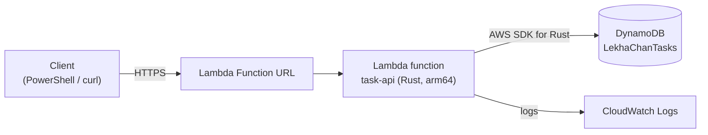
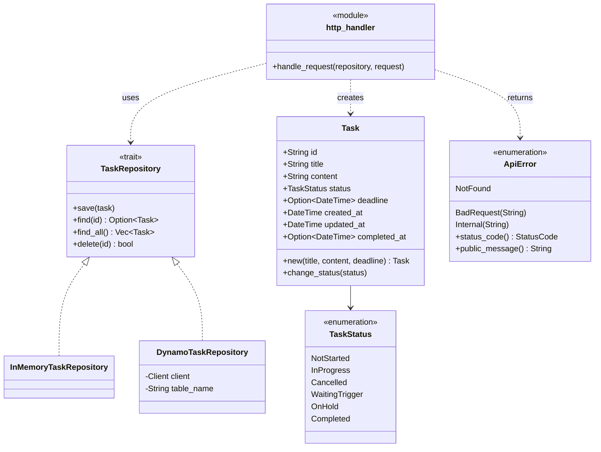
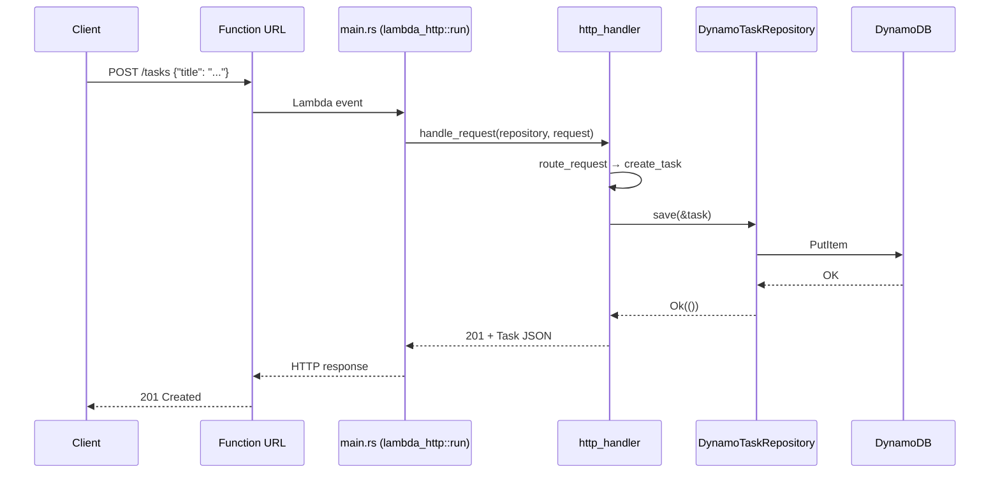

# Rust × AWS Lambda Hands-On (Server Side)

[日本語版](RustLambdaHandsOn.ja.md)

This hands-on guide takes you from a machine without Rust to a running **Task REST API on AWS Lambda written in Rust**, backed by DynamoDB.
It is written for people who are writing Rust for the first time. Each step adds a small piece of code and explains the Rust concepts it uses in a **🦀 Rust Point** box.

> Scope: server side only (Lambda + DynamoDB). No frontend.

## Contents

0. [What You Will Build](#0-what-you-will-build)
1. [Environment Setup (Windows)](#1-environment-setup-windows)
2. [Step 1: Hello Lambda](#2-step-1-hello-lambda)
3. [Step 2: Task Domain Model](#3-step-2-task-domain-model)
4. [Step 3: Repository Abstraction](#4-step-3-repository-abstraction)
5. [Step 4: HTTP Routing](#5-step-4-http-routing)
6. [Step 5: Persist to DynamoDB](#6-step-5-persist-to-dynamodb)
7. [Step 6: Deploy to AWS](#7-step-6-deploy-to-aws)
8. [Step 7: Clean Up](#8-step-7-clean-up)
9. [Troubleshooting](#9-troubleshooting)
10. [Next Steps](#10-next-steps)

### Verified Environment

Every command and code block in this guide was run on 2026-10-30 with:

| Item | Version |
| --- | --- |
| OS | Windows 11 (PowerShell 5.1) |
| Rust (rustc / cargo) | 1.99.1 |
| cargo-lambda | 1.9.2 |
| Zig | 0.16.0 |
| AWS CLI | 2.35.3 |
| lambda_http | 1.3.2 |
| aws-config / aws-sdk-dynamodb | 1.13.0 / 1.135.0 |

---

## 0. What You Will Build

A minimal version of the LekhaChan **Task** (see [Requirements.md](Requirements.md)) exposed as a REST API.

| Method | Path | Request body | Success response |
| --- | --- | --- | --- |
| `POST` | `/tasks` | `{"title", "content"?, "deadline"?}` | `201` + Task |
| `GET` | `/tasks` | – | `200` + Task[] |
| `GET` | `/tasks/{id}` | – | `200` + Task |
| `PATCH` | `/tasks/{id}/status` | `{"status"}` | `200` + Task |
| `DELETE` | `/tasks/{id}` | – | `204` |

Errors are returned as `{"error": "..."}` with status `400`, `404`, or `500`.

`status` takes one of `notStarted`, `inProgress`, `cancelled`, `waitingTrigger`, `onHold`, `completed`, which correspond to the task states in the requirements document.

### Architecture



### Class Diagram

Each file has one responsibility. The HTTP handler depends only on the `TaskRepository` trait, so the storage can be swapped (in-memory for tests, DynamoDB in production) without touching the handler.



### Sequence: `POST /tasks`



### Final File Layout

```text
task-api/
├─ Cargo.toml                       # package manifest (like package.json)
├─ iam/
│  ├─ trust-policy.json             # who may assume the Lambda role
│  └─ dynamodb-policy.json          # what the Lambda may do in DynamoDB
└─ src/
   ├─ main.rs                       # entry point: wiring only
   ├─ task.rs                       # domain model
   ├─ task_repository.rs            # storage abstraction (trait)
   ├─ in_memory_task_repository.rs  # storage for tests
   ├─ dynamo_task_repository.rs     # storage for production
   ├─ api_error.rs                  # error → HTTP status mapping
   └─ http_handler.rs               # routing and HTTP conversion
```

> **Note on file names:** Rust file names are module names, and the compiler warns unless they are `snake_case`.
> This guide therefore follows Rust's convention rather than the repository's UpperCamelCase file-name rule.

---

## 1. Environment Setup (Windows)

Use **PowerShell** for all commands. After each installation, **open a new terminal** so that `PATH` is reloaded.

### 1.1 C++ Build Tools (Linker)

Rust on Windows uses the MSVC linker (`link.exe`).
If you already have Visual Studio with the **"Desktop development with C++"** workload, skip this.
Otherwise, install "Build Tools for Visual Studio" and select that workload in the Visual Studio Installer.

### 1.2 Rust

```powershell
winget install --id Rustlang.Rustup -e
```

Open a new terminal:

```powershell
rustup default stable                          # install the stable toolchain (no-op if already installed)
rustup target add aarch64-unknown-linux-gnu    # standard library for Lambda (Linux, arm64)
rustc --version
cargo --version
```

`rustup` installs `rustc` (compiler), `cargo` (build tool and package manager), `rustfmt` (formatter) and `clippy` (linter).

### 1.3 VS Code Extension

```powershell
code --install-extension rust-lang.rust-analyzer
```

rust-analyzer gives you completion, inline type hints, and error highlighting. When you're new to Rust, the type hints help a lot.

### 1.4 cargo-lambda (and Zig)

[cargo-lambda](https://www.cargo-lambda.info/) creates, runs locally, builds, and deploys Rust Lambda functions.
Its WinGet installer also installs [Zig](https://ziglang.org/), which is used to cross-compile from Windows to Linux.

```powershell
winget install --id CargoLambda.CargoLambda -e
```

Open a new terminal:

```powershell
cargo lambda --version   # cargo-lambda 1.9.2 ...
zig version              # 0.13.0 or newer
```

If `zig` is not found, run `winget install --id zig.zig -e`.

### 1.5 AWS CLI and Credentials

This guide uses the region **ap-northeast-1 (Tokyo)**.

```powershell
aws --version
aws login                     # sign in through the browser with your AWS Console credentials
aws sts get-caller-identity   # prints your account ID if the credentials work
aws configure get region      # should print ap-northeast-1
```

#### Bridge Profile for cargo-lambda

cargo-lambda 1.9.2 bundles an AWS SDK version that **cannot read `aws login` sessions**.
If you deploy as-is, it fails with `the credential provider was not enabled`.
To work around this, add a profile that asks the AWS CLI for credentials (`credential_process`).

Open the config file:

```powershell
code $env:USERPROFILE\.aws\config
```

Append the following. If you ran `aws login` with a named profile, replace `default` with that name.

```ini
[profile cargo-lambda]
credential_process = aws configure export-credentials --profile default --format process
region = ap-northeast-1
```

Check:

```powershell
aws sts get-caller-identity --profile cargo-lambda
```

> If you use IAM Identity Center (`aws configure sso`) or access keys instead of `aws login`, you don't need this profile. Pass your own profile name to `--profile` in Step 6.

#### Using macOS / Linux?

Install with `curl https://sh.rustup.rs -sSf | sh` and `brew install cargo-lambda/tap/cargo-lambda`.
The rest of the guide is the same, except that you call the API with `curl` instead of `Invoke-RestMethod`.

---

## 2. Step 1: Hello Lambda

### 2.1 Create the Project

Create the project in a **short path**. Windows tools have a 260-character path limit, and deep folders can break the build (see [Troubleshooting](#9-troubleshooting)).

```powershell
mkdir C:\Dev -Force
cd C:\Dev
cargo lambda new task-api --http -y
cd task-api
code .
```

`--http` selects the HTTP template; `-y` accepts the default answers.

```text
task-api/
├─ .gitignore      # ignores target/ (build output)
├─ Cargo.toml
├─ README.md
└─ src/
   ├─ main.rs
   └─ http_handler.rs
```

### 2.2 Read the Generated Code

`src/main.rs`:

```rust
use lambda_http::{run, service_fn, tracing, Error};
mod http_handler;
use http_handler::function_handler;

#[tokio::main]
async fn main() -> Result<(), Error> {
    tracing::init_default_subscriber();

    run(service_fn(function_handler)).await
}
```

The core of `src/http_handler.rs`:

```rust
pub(crate) async fn function_handler(event: Request) -> Result<Response<Body>, Error> {
    // Extract some useful information from the request
    let who = event
        .query_string_parameters_ref()
        .and_then(|params| params.first("name"))
        .unwrap_or("world");
    let message = format!("Hello {who}, this is an AWS Lambda HTTP request");
    // ...builds a 200 response with `message` as the body
}
```

> **🦀 Rust Point: Cargo, crates, modules**
> - **Cargo** is the build tool and package manager (think `pnpm` + `tsc`). `Cargo.toml` is the equivalent of `package.json`, and libraries are called **crates**.
> - `mod http_handler;` declares a **module**, and its code lives in `src/http_handler.rs`. A file is not part of the build until some `mod` line declares it.
> - `use` brings names into scope, like `import`.

> **🦀 Rust Point: async and `Result`**
> - Rust has no built-in async runtime. `#[tokio::main]` starts the **tokio** runtime so that `async fn main` can run.
> - Rust has no exceptions. A function that can fail returns `Result<T, E>`, which is either `Ok(value)` or `Err(error)`.
> - `.unwrap_or("world")` turns "maybe a value" (`Option`) into a value by supplying a default.

### 2.3 Run It

Run the tests (the template comes with two):

```powershell
cargo test
```

Start the local Lambda emulator in **terminal A**. It rebuilds automatically whenever you save a file.

```powershell
cargo lambda watch
```

Call it from **terminal B**:

```powershell
Invoke-RestMethod "http://localhost:9000/?name=Rust"
# => Hello Rust, this is an AWS Lambda HTTP request
```

✏️ **Try it:** change the message in `http_handler.rs`, save, and call it again. The emulator reloads.

---

## 3. Step 2: Task Domain Model

### 3.1 Add Dependencies

```powershell
cargo add serde --features derive   # (de)serialization framework
cargo add serde_json                 # JSON support for serde
cargo add chrono --features serde    # date and time
cargo add uuid --features v4         # random IDs
cargo add thiserror                  # concise error type definitions
```

### 3.2 `src/task.rs`

Create the file:

```rust
//! Domain model of a LekhaChan task.

use chrono::{DateTime, Utc};
use serde::{Deserialize, Serialize};
use uuid::Uuid;

/// Progress state of a task.
#[derive(Debug, Clone, Copy, PartialEq, Eq, Serialize, Deserialize)]
#[serde(rename_all = "camelCase")]
pub enum TaskStatus {
    NotStarted,
    InProgress,
    Cancelled,
    WaitingTrigger,
    OnHold,
    Completed,
}

/// A unit of work managed by LekhaChan.
#[derive(Debug, Clone, PartialEq, Serialize, Deserialize)]
#[serde(rename_all = "camelCase")]
pub struct Task {
    /// Unique ID (UUID v4).
    pub id: String,
    /// Short title shown in lists.
    pub title: String,
    /// Task summary in Markdown.
    pub content: String,
    /// Current progress state.
    pub status: TaskStatus,
    /// Deadline, if any.
    pub deadline: Option<DateTime<Utc>>,
    /// When the task was created.
    pub created_at: DateTime<Utc>,
    /// When the task was last modified.
    pub updated_at: DateTime<Utc>,
    /// When the task became Completed; None otherwise.
    pub completed_at: Option<DateTime<Utc>>,
}

impl Task {
    /// Creates a new task in NotStarted status.
    pub fn new(title: String, content: String, deadline: Option<DateTime<Utc>>) -> Self {
        let now = Utc::now();
        Self {
            id: Uuid::new_v4().to_string(),
            title,
            content,
            status: TaskStatus::NotStarted,
            deadline,
            created_at: now,
            updated_at: now,
            completed_at: None,
        }
    }

    /// Changes the status, keeping updated_at and completed_at consistent.
    pub fn change_status(&mut self, status: TaskStatus) {
        let now = Utc::now();
        self.status = status;
        self.updated_at = now;
        self.completed_at = if status == TaskStatus::Completed {
            Some(now)
        } else {
            None
        };
    }
}

#[cfg(test)]
mod tests {
    use super::*;

    #[test]
    fn new_task_starts_as_not_started() {
        let task = Task::new("Write Rust".to_string(), String::new(), None);

        assert_eq!(task.status, TaskStatus::NotStarted);
        assert_eq!(task.completed_at, None);
    }

    #[test]
    fn completing_task_sets_completed_at() {
        let mut task = Task::new("Write Rust".to_string(), String::new(), None);

        task.change_status(TaskStatus::Completed);
        assert!(task.completed_at.is_some());

        task.change_status(TaskStatus::InProgress);
        assert_eq!(task.completed_at, None);
    }

    #[test]
    fn task_serializes_in_camel_case() {
        let task = Task::new("Write Rust".to_string(), String::new(), None);

        let json = serde_json::to_value(&task).unwrap();

        assert_eq!(json["status"], "notStarted");
        assert!(json.get("createdAt").is_some());
    }
}
```

Register the module in `src/main.rs` by adding one line below `mod http_handler;`:

```rust
mod task;
```

```powershell
cargo test   # 5 passed (2 template + 3 new)
```

Warnings such as `struct Task is never constructed` are expected; the code gets used in Step 4.

> **🦀 Rust Point: struct, enum, derive**
> - A `struct` groups fields together. An `enum` is a closed set of variants, and later (`ApiError`) you'll see that variants can carry data.
> - `#[derive(...)]` generates standard behavior automatically: `Debug` (printing with `{:?}`), `Clone` (`.clone()`), `PartialEq` (`==`), and `Serialize`/`Deserialize` (JSON conversion through serde).
> - `#[serde(rename_all = "camelCase")]` maps `created_at` in Rust to `createdAt` in JSON.

> **🦀 Rust Point: `Option` instead of null**
> - Rust has no `null`. A value that may be absent has type `Option<T>`, which is either `Some(value)` or `None`. The compiler forces you to handle both.

> **🦀 Rust Point: ownership and borrowing**
> - `String` is an **owned** string, and `&str` is a **borrowed** view of one. `"Write Rust".to_string()` makes an owned copy.
> - `Task::new(title: String, ...)` takes ownership: the strings are **moved** into the `Task`, and the caller can't use them afterwards.
> - Variables are immutable by default. `let mut task` makes one mutable, and `&mut self` means "this method borrows the task mutably".

> **🦀 Rust Point: tests live next to the code**
> - `#[cfg(test)] mod tests { ... }` is compiled only by `cargo test`. `use super::*;` imports everything from the parent module.

---

## 4. Step 3: Repository Abstraction

The handler should not care where tasks are stored, so we define the operations as a **trait** (an interface) and implement it twice: in memory now, and in DynamoDB in Step 5.

### 4.1 `src/task_repository.rs`

```rust
//! Storage abstraction for tasks, so handlers do not depend on a concrete database.

use std::future::Future;

use crate::task::Task;

/// Failure inside a TaskRepository implementation.
#[derive(Debug, thiserror::Error)]
#[error("repository error: {0}")]
pub struct RepositoryError(pub String);

/// Persistent store of tasks.
pub trait TaskRepository: Send + Sync {
    /// Inserts the task, or overwrites it if the ID already exists.
    fn save(&self, task: &Task) -> impl Future<Output = Result<(), RepositoryError>> + Send;

    /// Finds a task by ID; Ok(None) if it does not exist.
    fn find(&self, id: &str) -> impl Future<Output = Result<Option<Task>, RepositoryError>> + Send;

    /// Returns every task.
    fn find_all(&self) -> impl Future<Output = Result<Vec<Task>, RepositoryError>> + Send;

    /// Deletes a task by ID; Ok(false) if it did not exist.
    fn delete(&self, id: &str) -> impl Future<Output = Result<bool, RepositoryError>> + Send;
}
```

### 4.2 `src/in_memory_task_repository.rs`

```rust
//! TaskRepository that keeps tasks in process memory, for tests and local trials.

use std::collections::HashMap;
use std::sync::{Mutex, MutexGuard};

use crate::task::Task;
use crate::task_repository::{RepositoryError, TaskRepository};

/// Tasks stored in a HashMap; lost when the process exits.
#[derive(Default)]
pub struct InMemoryTaskRepository {
    tasks: Mutex<HashMap<String, Task>>,
}

impl InMemoryTaskRepository {
    fn lock_tasks(&self) -> Result<MutexGuard<'_, HashMap<String, Task>>, RepositoryError> {
        self.tasks
            .lock()
            .map_err(|error| RepositoryError(error.to_string()))
    }
}

impl TaskRepository for InMemoryTaskRepository {
    async fn save(&self, task: &Task) -> Result<(), RepositoryError> {
        let mut tasks = self.lock_tasks()?;
        tasks.insert(task.id.clone(), task.clone());
        Ok(())
    }

    async fn find(&self, id: &str) -> Result<Option<Task>, RepositoryError> {
        let tasks = self.lock_tasks()?;
        Ok(tasks.get(id).cloned())
    }

    async fn find_all(&self) -> Result<Vec<Task>, RepositoryError> {
        let tasks = self.lock_tasks()?;
        Ok(tasks.values().cloned().collect())
    }

    async fn delete(&self, id: &str) -> Result<bool, RepositoryError> {
        let mut tasks = self.lock_tasks()?;
        Ok(tasks.remove(id).is_some())
    }
}
```

Add both modules to `src/main.rs`:

```rust
mod in_memory_task_repository;
mod task_repository;
```

```powershell
cargo build
```

> **🦀 Rust Point: traits**
> - A `trait` is like an interface in TypeScript. `impl TaskRepository for InMemoryTaskRepository` says "this type fulfills the contract".
> - `Send + Sync` means "safe to move to, and share between, threads". tokio may run your code on any thread, so a shared repository must be thread-safe.

> **🦀 Rust Point: async methods in traits**
> - The trait spells out `impl Future<Output = ...> + Send` so that callers know the returned future can cross threads. Implementations can simply write `async fn`, as above.

> **🦀 Rust Point: `?` and `map_err`**
> - `expr?` means "if this is `Err`, return it from the current function now; otherwise unwrap the `Ok` value". It replaces try/catch.
> - `.map_err(|error| ...)` converts one error type into another. `|error| ...` is a closure (a lambda).

> **🦀 Rust Point: `Mutex` and `.cloned()`**
> - The methods take `&self` (a shared borrow) but still need to modify the map. `Mutex` allows that safely: `lock()` gives you exclusive access until the guard goes out of scope.
> - We return `.cloned()` copies because a reference into the map can't outlive the lock.

---

## 5. Step 4: HTTP Routing

### 5.1 `src/api_error.rs`

```rust
//! Errors returned to API clients, each mapped to an HTTP status code.

use lambda_http::http::StatusCode;

use crate::task_repository::RepositoryError;

/// Error that ends a request with a non-2xx response.
#[derive(Debug, thiserror::Error)]
pub enum ApiError {
    /// The route or the task does not exist.
    #[error("not found")]
    NotFound,
    /// The client sent invalid input.
    #[error("bad request: {0}")]
    BadRequest(String),
    /// Something failed on the server side.
    #[error("internal error: {0}")]
    Internal(String),
}

impl ApiError {
    /// Returns the HTTP status code for this error.
    pub fn status_code(&self) -> StatusCode {
        match self {
            ApiError::NotFound => StatusCode::NOT_FOUND,
            ApiError::BadRequest(_) => StatusCode::BAD_REQUEST,
            ApiError::Internal(_) => StatusCode::INTERNAL_SERVER_ERROR,
        }
    }

    /// Returns the message shown to clients; internal details stay in the logs.
    pub fn public_message(&self) -> String {
        match self {
            ApiError::Internal(_) => "internal error".to_string(),
            other => other.to_string(),
        }
    }
}

// Lets `?` turn a RepositoryError into an ApiError automatically.
impl From<RepositoryError> for ApiError {
    fn from(error: RepositoryError) -> Self {
        ApiError::Internal(error.to_string())
    }
}
```

### 5.2 `src/http_handler.rs`

Replace the whole template file with this:

```rust
//! Routes HTTP requests to task operations and converts results into HTTP responses.

use chrono::{DateTime, Utc};
use lambda_http::http::header::{HeaderValue, CONTENT_TYPE};
use lambda_http::http::{Method, StatusCode};
use lambda_http::{tracing, Body, Error, Request, Response};
use serde::de::DeserializeOwned;
use serde::{Deserialize, Serialize};

use crate::api_error::ApiError;
use crate::task::{Task, TaskStatus};
use crate::task_repository::TaskRepository;

/// Body of POST /tasks.
#[derive(Debug, Deserialize)]
#[serde(rename_all = "camelCase")]
struct TaskCreationRequest {
    title: String,
    #[serde(default)]
    content: String,
    deadline: Option<DateTime<Utc>>,
}

/// Body of PATCH /tasks/{id}/status.
#[derive(Debug, Deserialize)]
struct TaskStatusChangeRequest {
    status: TaskStatus,
}

/// Lambda entry point for every HTTP request; never fails, errors become JSON responses.
pub async fn handle_request<R: TaskRepository>(
    repository: &R,
    request: Request,
) -> Result<Response<Body>, Error> {
    match route_request(repository, &request).await {
        Ok(response) => Ok(response),
        Err(error) => {
            tracing::warn!(%error, "request failed");
            let json = serde_json::json!({ "error": error.public_message() }).to_string();
            Ok(build_json_response(error.status_code(), json))
        }
    }
}

async fn route_request<R: TaskRepository>(
    repository: &R,
    request: &Request,
) -> Result<Response<Body>, ApiError> {
    // "/tasks/abc/status" -> ["tasks", "abc", "status"]
    let segments: Vec<&str> = request
        .uri()
        .path()
        .split('/')
        .filter(|segment| !segment.is_empty())
        .collect();

    match (request.method(), segments.as_slice()) {
        (&Method::GET, ["tasks"]) => list_tasks(repository).await,
        (&Method::POST, ["tasks"]) => create_task(repository, request).await,
        (&Method::GET, ["tasks", id]) => get_task(repository, id).await,
        (&Method::PATCH, ["tasks", id, "status"]) => {
            change_task_status(repository, id, request).await
        }
        (&Method::DELETE, ["tasks", id]) => delete_task(repository, id).await,
        _ => Err(ApiError::NotFound),
    }
}

async fn list_tasks<R: TaskRepository>(repository: &R) -> Result<Response<Body>, ApiError> {
    let tasks = repository.find_all().await?;
    serialize_json_response(StatusCode::OK, &tasks)
}

async fn create_task<R: TaskRepository>(
    repository: &R,
    request: &Request,
) -> Result<Response<Body>, ApiError> {
    let creation: TaskCreationRequest = parse_json_body(request)?;
    if creation.title.trim().is_empty() {
        return Err(ApiError::BadRequest("title must not be empty".to_string()));
    }

    let task = Task::new(creation.title, creation.content, creation.deadline);
    repository.save(&task).await?;
    serialize_json_response(StatusCode::CREATED, &task)
}

async fn get_task<R: TaskRepository>(repository: &R, id: &str) -> Result<Response<Body>, ApiError> {
    let task = repository.find(id).await?.ok_or(ApiError::NotFound)?;
    serialize_json_response(StatusCode::OK, &task)
}

async fn change_task_status<R: TaskRepository>(
    repository: &R,
    id: &str,
    request: &Request,
) -> Result<Response<Body>, ApiError> {
    let change: TaskStatusChangeRequest = parse_json_body(request)?;

    let mut task = repository.find(id).await?.ok_or(ApiError::NotFound)?;
    task.change_status(change.status);
    repository.save(&task).await?;
    serialize_json_response(StatusCode::OK, &task)
}

async fn delete_task<R: TaskRepository>(
    repository: &R,
    id: &str,
) -> Result<Response<Body>, ApiError> {
    if !repository.delete(id).await? {
        return Err(ApiError::NotFound);
    }
    Response::builder()
        .status(StatusCode::NO_CONTENT)
        .body(Body::Empty)
        .map_err(|error| ApiError::Internal(error.to_string()))
}

fn parse_json_body<T: DeserializeOwned>(request: &Request) -> Result<T, ApiError> {
    serde_json::from_slice(request.body().as_ref())
        .map_err(|error| ApiError::BadRequest(error.to_string()))
}

fn serialize_json_response<T: Serialize>(
    status: StatusCode,
    value: &T,
) -> Result<Response<Body>, ApiError> {
    let json =
        serde_json::to_string(value).map_err(|error| ApiError::Internal(error.to_string()))?;
    Ok(build_json_response(status, json))
}

fn build_json_response(status: StatusCode, json: String) -> Response<Body> {
    let mut response = Response::new(Body::from(json));
    *response.status_mut() = status;
    // charset is required for non-ASCII text to display correctly in Windows PowerShell 5.1.
    response.headers_mut().insert(
        CONTENT_TYPE,
        HeaderValue::from_static("application/json; charset=utf-8"),
    );
    response
}

#[cfg(test)]
mod tests {
    use super::*;
    use crate::in_memory_task_repository::InMemoryTaskRepository;

    fn build_request(method: &str, path: &str, body: &str) -> Request {
        lambda_http::http::Request::builder()
            .method(method)
            .uri(path)
            .body(Body::from(body.to_string()))
            .unwrap()
    }

    fn read_json(response: &Response<Body>) -> serde_json::Value {
        serde_json::from_slice(response.body().as_ref()).unwrap()
    }

    #[tokio::test]
    async fn created_task_can_be_fetched() {
        let repository = InMemoryTaskRepository::default();

        let created = handle_request(
            &repository,
            build_request("POST", "/tasks", r#"{"title":"Write Rust"}"#),
        )
        .await
        .unwrap();
        assert_eq!(created.status(), StatusCode::CREATED);
        let id = read_json(&created)["id"].as_str().unwrap().to_string();

        let fetched = handle_request(
            &repository,
            build_request("GET", &format!("/tasks/{id}"), ""),
        )
        .await
        .unwrap();
        assert_eq!(fetched.status(), StatusCode::OK);
        assert_eq!(read_json(&fetched)["title"], "Write Rust");
    }

    #[tokio::test]
    async fn unknown_task_returns_404() {
        let repository = InMemoryTaskRepository::default();

        let response = handle_request(&repository, build_request("GET", "/tasks/unknown", ""))
            .await
            .unwrap();

        assert_eq!(response.status(), StatusCode::NOT_FOUND);
    }

    #[tokio::test]
    async fn empty_title_returns_400() {
        let repository = InMemoryTaskRepository::default();

        let response = handle_request(
            &repository,
            build_request("POST", "/tasks", r#"{"title":""}"#),
        )
        .await
        .unwrap();

        assert_eq!(response.status(), StatusCode::BAD_REQUEST);
    }
}
```

### 5.3 `src/main.rs`

Replace the whole file:

```rust
//! Lambda entry point: chooses a TaskRepository and hands every request to the HTTP handler.

mod api_error;
mod http_handler;
mod in_memory_task_repository;
mod task;
mod task_repository;

use lambda_http::{run, service_fn, tracing, Error};

use http_handler::handle_request;
use in_memory_task_repository::InMemoryTaskRepository;

#[tokio::main]
async fn main() -> Result<(), Error> {
    tracing::init_default_subscriber();

    let repository = InMemoryTaskRepository::default();
    let repository_ref = &repository;

    run(service_fn(move |request| async move {
        handle_request(repository_ref, request).await
    }))
    .await
}
```

### 5.4 Test and Try

```powershell
cargo test    # 6 passed
cargo clippy  # linter: no warnings expected
cargo fmt     # formatter
```

Start `cargo lambda watch` in terminal A (restart it if it's still running from Step 1), then run in terminal B:

```powershell
$base = "http://localhost:9000"

# Create
$task = Invoke-RestMethod -Method Post -Uri "$base/tasks" `
  -ContentType "application/json; charset=utf-8" `
  -Body '{"title": "Rustを書く", "content": "# 初めてのRust", "deadline": "2026-11-30T15:00:00Z"}'
$task

# List / get one
Invoke-RestMethod "$base/tasks"
Invoke-RestMethod "$base/tasks/$($task.id)"

# Change status
Invoke-RestMethod -Method Patch -Uri "$base/tasks/$($task.id)/status" `
  -ContentType "application/json; charset=utf-8" -Body '{"status": "completed"}'

# Delete (204 No Content)
Invoke-WebRequest -Method Delete -Uri "$base/tasks/$($task.id)" -UseBasicParsing | Select-Object StatusCode

# Errors: PowerShell shows the JSON error body
Invoke-RestMethod -Method Post -Uri "$base/tasks" -ContentType "application/json; charset=utf-8" -Body '{"title": ""}'   # 400
Invoke-RestMethod "$base/tasks/unknown"                                                                                 # 404
Invoke-RestMethod -Method Patch -Uri "$base/tasks/x/status" -ContentType "application/json; charset=utf-8" -Body '{"status": "done"}'  # 400: unknown variant
```

> ⚠️ Always include `; charset=utf-8` in `-ContentType`. Without it, Windows PowerShell 5.1 sends Japanese text as `???`.

Data disappears whenever `cargo lambda watch` rebuilds, because it lives in process memory. Step 5 fixes that.

> **🦀 Rust Point: generics**
> - `handle_request<R: TaskRepository>(repository: &R, ...)` accepts **any type that implements `TaskRepository`**. The compiler generates a specialized copy for each concrete type (static dispatch), so the abstraction costs nothing at runtime.

> **🦀 Rust Point: pattern matching**
> - `match (request.method(), segments.as_slice())` matches a tuple. `["tasks", id]` is a **slice pattern**: it matches a two-element path whose first element is `"tasks"` and binds the second to `id`.
> - `match` must cover every case, so `_ => Err(ApiError::NotFound)` handles everything else.

> **🦀 Rust Point: error conversion**
> - `impl From<RepositoryError> for ApiError` teaches `?` how to convert. That's why `repository.find_all().await?` works inside a function that returns `ApiError`.
> - `.ok_or(ApiError::NotFound)?` turns `Option<Task>` into `Result<Task, ApiError>`, and then `?` unwraps it.

> **🦀 Rust Point: closures and borrowing in `main`**
> - `move |request| async move { ... }` is a closure that returns a future. `move` copies `repository_ref` (a reference) into it.
> - Borrowing `&repository` is allowed because `repository` lives until `main` returns, and `run` keeps running until the Lambda instance shuts down.

> **🦀 Rust Point: raw strings**
> - `r#"{"title":"Write Rust"}"#` is a raw string, so the double quotes inside don't need escaping.

---

## 6. Step 5: Persist to DynamoDB

From here on you will create real AWS resources. The cost of this hands-on is negligible, but delete the resources in [Step 7](#8-step-7-clean-up) when you're done.

### 6.1 Create the Table

```powershell
aws dynamodb create-table `
  --table-name LekhaChanTasks `
  --attribute-definitions AttributeName=id,AttributeType=S `
  --key-schema AttributeName=id,KeyType=HASH `
  --billing-mode PAY_PER_REQUEST `
  --query TableDescription.TableArn --output text
```

This prints the **table ARN** (e.g. `arn:aws:dynamodb:ap-northeast-1:123456789012:table/LekhaChanTasks`). Keep it; you'll need it in Step 6.

### 6.2 Add Dependencies

```powershell
cargo add aws-config --features credentials-login   # loads region and credentials; credentials-login reads `aws login` sessions
cargo add aws-sdk-dynamodb                           # DynamoDB client
cargo add serde_dynamo --features aws-sdk-dynamodb+1 # converts structs <-> DynamoDB items
```

The resulting `Cargo.toml` (your versions may be newer):

```toml
[package]
name = "task-api"
version = "0.1.0"
edition = "2021"

[dependencies]
aws-config = { version = "1.13.0", features = ["credentials-login"] }
aws-sdk-dynamodb = "1.135.0"
chrono = { version = "0.4.45", features = ["serde"] }
lambda_http = "1.0.0"
serde = { version = "1.0.229", features = ["derive"] }
serde_dynamo = { version = "4.3.0", features = ["aws-sdk-dynamodb+1"] }
serde_json = "1.0.154"
thiserror = "2.0.21"

tokio = { version = "1", features = ["macros"] }
uuid = { version = "1.29.0", features = ["v4"] }
```

### 6.3 `src/dynamo_task_repository.rs`

```rust
//! TaskRepository backed by an Amazon DynamoDB table whose partition key is "id" (String).

use aws_sdk_dynamodb::error::DisplayErrorContext;
use aws_sdk_dynamodb::types::{AttributeValue, ReturnValue};
use aws_sdk_dynamodb::Client;

use crate::task::Task;
use crate::task_repository::{RepositoryError, TaskRepository};

/// Stores each Task as one DynamoDB item.
pub struct DynamoTaskRepository {
    client: Client,
    table_name: String,
}

impl DynamoTaskRepository {
    /// Creates a repository that reads and writes `table_name`.
    pub fn new(client: Client, table_name: String) -> Self {
        Self { client, table_name }
    }
}

impl TaskRepository for DynamoTaskRepository {
    async fn save(&self, task: &Task) -> Result<(), RepositoryError> {
        let item = serde_dynamo::to_item(task).map_err(wrap_error)?;
        self.client
            .put_item()
            .table_name(&self.table_name)
            .set_item(Some(item))
            .send()
            .await
            .map_err(wrap_error)?;
        Ok(())
    }

    async fn find(&self, id: &str) -> Result<Option<Task>, RepositoryError> {
        let output = self
            .client
            .get_item()
            .table_name(&self.table_name)
            .key("id", AttributeValue::S(id.to_string()))
            .send()
            .await
            .map_err(wrap_error)?;

        match output.item {
            Some(item) => Ok(Some(serde_dynamo::from_item(item).map_err(wrap_error)?)),
            None => Ok(None),
        }
    }

    async fn find_all(&self) -> Result<Vec<Task>, RepositoryError> {
        // Scan reads the whole table; acceptable for a personal-scale task list.
        let items = self
            .client
            .scan()
            .table_name(&self.table_name)
            .into_paginator()
            .items()
            .send()
            .collect::<Result<Vec<_>, _>>()
            .await
            .map_err(wrap_error)?;

        serde_dynamo::from_items(items).map_err(wrap_error)
    }

    async fn delete(&self, id: &str) -> Result<bool, RepositoryError> {
        let output = self
            .client
            .delete_item()
            .table_name(&self.table_name)
            .key("id", AttributeValue::S(id.to_string()))
            .return_values(ReturnValue::AllOld)
            .send()
            .await
            .map_err(wrap_error)?;

        // AllOld returns the deleted item, so None means it did not exist.
        Ok(output.attributes.is_some())
    }
}

fn wrap_error(error: impl std::error::Error) -> RepositoryError {
    RepositoryError(DisplayErrorContext(error).to_string())
}

#[cfg(test)]
mod tests {
    use super::*;

    #[test]
    fn task_round_trips_through_dynamodb_item() {
        let task = Task::new("Write Rust".to_string(), String::new(), None);

        let item: serde_dynamo::Item = serde_dynamo::to_item(&task).unwrap();
        let restored: Task = serde_dynamo::from_item(item).unwrap();

        assert_eq!(restored, task);
    }
}
```

### 6.4 Switch `main.rs` to DynamoDB

```rust
//! Lambda entry point: chooses a TaskRepository and hands every request to the HTTP handler.

mod api_error;
mod dynamo_task_repository;
mod http_handler;
#[cfg(test)]
mod in_memory_task_repository;
mod task;
mod task_repository;

use aws_config::BehaviorVersion;
use lambda_http::{run, service_fn, tracing, Error};

use dynamo_task_repository::DynamoTaskRepository;
use http_handler::handle_request;

#[tokio::main]
async fn main() -> Result<(), Error> {
    tracing::init_default_subscriber();

    // Created once per Lambda instance and reused across invocations.
    let table_name = std::env::var("TASK_TABLE_NAME")?;
    let aws_config = aws_config::load_defaults(BehaviorVersion::latest()).await;
    let repository =
        DynamoTaskRepository::new(aws_sdk_dynamodb::Client::new(&aws_config), table_name);
    let repository_ref = &repository;

    run(service_fn(move |request| async move {
        handle_request(repository_ref, request).await
    }))
    .await
}
```

Only `main.rs` changed. `http_handler.rs` is untouched: this is the payoff of depending on the trait (Dependency Inversion Principle).

### 6.5 Run Locally Against Real DynamoDB

```powershell
cargo test   # 7 passed
```

Terminal A (the table name is passed as an environment variable):

```powershell
cargo lambda watch --env-var TASK_TABLE_NAME=LekhaChanTasks
```

Terminal B: run the same commands as in [5.4](#54-test-and-try). Then look at the table:

```powershell
aws dynamodb scan --table-name LekhaChanTasks
```

Each task is stored as one item: `"title": {"S": "..."}`, `"deadline": {"NULL": true}`, and so on. Data now survives rebuilds.

> Locally, the function uses your `aws login` credentials through the `credentials-login` feature. On Lambda, it uses the execution role's credentials automatically, and the same code works in both places.

> **🦀 Rust Point: builder pattern**
> - The AWS SDK builds requests by method chaining: `.put_item().table_name(...).set_item(...).send().await`. Nothing is sent until `.send()`, and nothing runs until `.await`.

> **🦀 Rust Point: `impl Trait` in arguments**
> - `fn wrap_error(error: impl std::error::Error)` accepts any error type, which is shorthand for a generic function. `DisplayErrorContext` prints the whole error chain, which is much more useful than the default "service error".

> **🦀 Rust Point: conditional compilation**
> - `#[cfg(test)] mod in_memory_task_repository;` compiles the in-memory repository only for tests, so the production binary contains no unused code.

> **🦀 Rust Point: initialize once, reuse**
> - Everything before `run(...)` runs once per Lambda instance (cold start). The DynamoDB client is created there and reused by every invocation, which keeps requests fast.

---

## 7. Step 6: Deploy to AWS

### 7.1 Execution Role

A Lambda function runs with an **IAM role** that decides what it may do. Create two files in the project.

`iam/trust-policy.json` (allows the Lambda service to use the role):

```json
{
  "Version": "2012-10-17",
  "Statement": [
    {
      "Effect": "Allow",
      "Principal": { "Service": "lambda.amazonaws.com" },
      "Action": "sts:AssumeRole"
    }
  ]
}
```

`iam/dynamodb-policy.json` (replace `Resource` with your table ARN from 6.1):

```json
{
  "Version": "2012-10-17",
  "Statement": [
    {
      "Effect": "Allow",
      "Action": [
        "dynamodb:GetItem",
        "dynamodb:PutItem",
        "dynamodb:DeleteItem",
        "dynamodb:Scan"
      ],
      "Resource": "arn:aws:dynamodb:ap-northeast-1:123456789012:table/LekhaChanTasks"
    }
  ]
}
```

Create the files in VS Code so that they're saved as UTF-8. Then:

```powershell
# Role (prints its ARN into $roleArn)
$roleArn = aws iam create-role --role-name LekhaChanTaskApiRole `
  --assume-role-policy-document file://iam/trust-policy.json `
  --query Role.Arn --output text

# Permission to write CloudWatch Logs
aws iam attach-role-policy --role-name LekhaChanTaskApiRole `
  --policy-arn arn:aws:iam::aws:policy/service-role/AWSLambdaBasicExecutionRole

# Permission for the table only (least privilege)
aws iam put-role-policy --role-name LekhaChanTaskApiRole `
  --policy-name LekhaChanTasksAccess --policy-document file://iam/dynamodb-policy.json

$roleArn
```

If you open a new terminal later, get the ARN again with `$roleArn = aws iam get-role --role-name LekhaChanTaskApiRole --query Role.Arn --output text`.

### 7.2 Build

```powershell
cargo lambda build --release --arm64
```

This cross-compiles for Linux on ARM64 (Graviton), which is cheaper than x86_64 and starts fast.
The first build takes a few minutes. The output is `target/lambda/task-api/bootstrap`, a single executable that **is** the whole function.

### 7.3 Deploy

```powershell
cargo lambda deploy --profile cargo-lambda `
  --iam-role $roleArn `
  --env-var TASK_TABLE_NAME=LekhaChanTasks `
  --enable-function-url `
  task-api
```

This creates the Lambda function `task-api` (runtime `provided.al2023`, architecture detected from the binary) and a **Function URL**.

> ⚠️ **The Function URL created by `--enable-function-url` has no authentication.** Anyone who knows the URL can read and write your tasks.
> Use it only for this exercise, and delete it in Step 7 (or run the deploy again with `--disable-function-url`). See [Next Steps](#10-next-steps) for real authentication.

### 7.4 Call the Deployed API

```powershell
$url = (aws lambda get-function-url-config --function-name task-api --query FunctionUrl --output text).TrimEnd('/')

$task = Invoke-RestMethod -Method Post -Uri "$url/tasks" `
  -ContentType "application/json; charset=utf-8" -Body '{"title": "Lambdaから登録"}'
Invoke-RestMethod "$url/tasks"
```

The first request after a deploy is a **cold start**. Rust cold starts are short, and later requests are faster still.

Watch the logs (`tracing` output, including `request failed` warnings) live:

```powershell
aws logs tail /aws/lambda/task-api --follow
```

### 7.5 Redeploying After Code Changes

```powershell
cargo test
cargo lambda build --release --arm64
cargo lambda deploy --profile cargo-lambda --env-var TASK_TABLE_NAME=LekhaChanTasks task-api
```

> `deploy` **replaces all environment variables** by default, so always pass `--env-var` again. The role does not need to be specified again.

---

## 8. Step 7: Clean Up

```powershell
aws lambda delete-function --function-name task-api
aws logs delete-log-group --log-group-name /aws/lambda/task-api
aws dynamodb delete-table --table-name LekhaChanTasks --query TableDescription.TableStatus
aws iam delete-role-policy --role-name LekhaChanTaskApiRole --policy-name LekhaChanTasksAccess
aws iam detach-role-policy --role-name LekhaChanTaskApiRole `
  --policy-arn arn:aws:iam::aws:policy/service-role/AWSLambdaBasicExecutionRole
aws iam delete-role --role-name LekhaChanTaskApiRole
```

Deleting the function also deletes its Function URL.

---

## 9. Troubleshooting

| Symptom | Cause / Fix |
| --- | --- |
| `linker 'link.exe' not found` | MSVC build tools are missing. Install the "Desktop development with C++" workload ([1.1](#11-c-build-tools-linker)). |
| `LNK1104: cannot open file ...` or `Cannot open include file` with very long paths | The Windows 260-character path limit. Keep the project in a short path (e.g. `C:\Dev\task-api`) and leave Cargo in its default location (`%USERPROFILE%\.cargo`). |
| `Zig is not installed in your system` | Run `winget install --id zig.zig -e` and open a new terminal. |
| `cargo lambda deploy` fails with `the credential provider was not enabled` / `no providers in chain provided credentials` | cargo-lambda can't read `aws login` sessions. Use the bridge profile (`--profile cargo-lambda`, [1.5](#15-aws-cli-and-credentials)). |
| Your function fails locally with the same credentials error | `aws-config` needs the `credentials-login` feature ([6.2](#62-add-dependencies)). Also check that `aws login` hasn't expired. |
| Japanese text shows as `???` or mojibake in PowerShell | Add `; charset=utf-8` to `-ContentType`. The server already sends `charset=utf-8`. |
| `The role defined for the function cannot be assumed by Lambda` | A newly created IAM role takes a few seconds to propagate. Wait about 10 seconds and deploy again. |
| `403 Forbidden` from the Function URL | Since October 2025, a public Function URL needs both `lambda:InvokeFunctionUrl` and `lambda:InvokeFunction` in the resource policy. cargo-lambda 1.9.2 adds both; check with `aws lambda get-policy --function-name task-api`. |
| `{"error":"internal error"}` | Details are deliberately kept out of the response. Check the `cargo lambda watch` terminal or `aws logs tail`. `AccessDeniedException` means the table ARN in `dynamodb-policy.json` is wrong. |
| The function exits at startup with `environment variable not found` | `TASK_TABLE_NAME` is missing. Pass `--env-var TASK_TABLE_NAME=LekhaChanTasks`. |
| `WARN AWS_LAMBDA_MAX_CONCURRENCY is set to '1'...` in `cargo lambda watch` | Harmless. |
| `warning: linker stderr: ignoring deprecated linker optimization setting '1'` in release builds | Harmless message from Zig. |

---

## 10. Next Steps

- **Authentication:** switch the Function URL to `AWS_IAM` auth, or put API Gateway with a JWT authorizer in front of it.
- **Infrastructure as Code:** manage the table, role, and function with AWS SAM or AWS CDK instead of manual CLI commands.
- **Query design:** replace `Scan` with `Query` on a GSI (for example, tasks by status or deadline) as the data grows.
- **More of the domain:** projects, priorities, and AI agent settings from [Requirements.md](Requirements.md).
- **CI:** run `cargo fmt --check`, `cargo clippy -- -D warnings`, and `cargo test` on every push.

### References

- [The Rust Programming Language](https://doc.rust-lang.org/book/) ([Japanese translation](https://doc.rust-jp.rs/book-ja/))
- [Rust by Example](https://doc.rust-lang.org/rust-by-example/)
- [Cargo Lambda documentation](https://www.cargo-lambda.info/)
- [aws-lambda-rust-runtime examples](https://github.com/awslabs/aws-lambda-rust-runtime/tree/main/examples)
- [AWS SDK for Rust Developer Guide](https://docs.aws.amazon.com/sdk-for-rust/latest/dg/)
- [Login credentials provider (`aws login`)](https://docs.aws.amazon.com/sdkref/latest/guide/feature-login-credentials.html)
- [Control access to Lambda function URLs](https://docs.aws.amazon.com/lambda/latest/dg/urls-auth.html)
